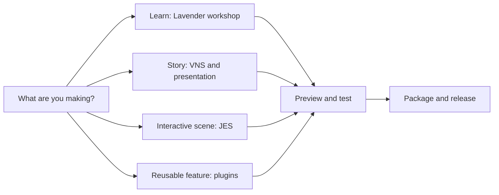

# JVN Documentation

> [!TIP]
> New to JVN? Start with [Lavender’s playable workshop](guides/lavender-workshop.md). Looking up one behavior? Use the [task index](INDEX.md). The [reading guide](guides/reading-the-docs.md) explains diagrams, annotations, and runnable examples.

The diagram is a route map, not a required sequence. Use the reference pages alongside the tool or script you are editing.

This directory is the source of truth for Java Vector Nexus editor, runtime, scripting, packaging, and workflow docs.

Start with the public documentation website at [javavectornexus.com](https://javavectornexus.com)
when you want the searchable, hosted guide tree. Start with the detailed [Documentation Index](INDEX.md)
when editing docs in this repository. It is organized by task first, then by subsystem.

## Fast Routes

| Goal | Start Here |
|------|------------|
| Build and run JVN | [Getting Started Guide](guides/getting-started.md) |
| Understand why JVN is source-first for now | [No Prebuilt Download Yet](guides/getting-started.md#why-there-is-no-prebuilt-download-yet) |
| Use or install the Engine Hub | [JVN Engine Hub](editor/core/engine-hub.md) |
| Decide which layer to use | [Choose Your Path in JVN](guides/choose-your-path.md) |
| Identify project file types | [Common JVN File Types](guides/common-file-types.md) |
| Work inside the editor | [JVN Editor Docs](editor/README.md) |
| Animate shots | [Puppeteer Editor Guide](editor/puppeteer/puppeteer-editor-guide.md) |
| Export lighting/stage presets | [Scene Lighting Studio](editor/sidebars/right/sidebar-image-tint-tool.md) |
| Write VN scripts | [VNS Overview](scripting/vns/overview/vns-scripting.md) |
| Write gameplay scenes | [JES Overview](scripting/jes/overview/jes-scripting.md) |
| Check portable VNS/JES syntax | [Scripting Language Contract](scripting/spec/README.md) |
| Build menus and layouts | [Menu Profiles Overview](scripting/ui/menus/menu-profiles.md) |
| Deploy to mobile/web | [Platform Runtimes](runtime/platforms/README.md) |
| Package a game | [Build And Release Docs](project-setup/release/README.md) |
| Build a JVN plugin | [Plugin Authoring](plugins/authoring.md) |

## Directory Map

| Directory | Coverage |
|-----------|----------|
| [`architecture/`](architecture/README.md) | Engine architecture, 2D rendering, performance, debugging, and UI parity notes |
| [`editor/`](editor/README.md) | Engine Hub, editor windows, settings, Puppeteer, sidebars, and editor-owned file formats |
| [`guides/`](guides/README.md) | Onboarding, by-example tutorials, cookbooks, integration recipes, and file-type orientation |
| [`project-setup/`](project-setup/README.md) | Project creation, content setup, collaboration, build, release, and deployment |
| [`plugins/`](plugins/README.md) | Plugin authoring, manifests, extension points, lifecycle, packaging, and compatibility |
| [`runtime/`](runtime/README.md) | Runtime behavior, interop, save/load, audio, asset resolution, and platform backends |
| [`scripting/`](scripting/README.md) | VNS, JES, contracts, timelines, menu profiles, layout DSL, and scripting internals |

## Maintenance Notes

- Generated screenshot docs use `generated-*.md` names and are refreshed by docs screenshot tasks.
- Prefer linking to section landing pages first, then deep pages for specific APIs or tools.
- Keep implementation-specific docs anchored to current source file names when possible, especially under `editor/`.
- Follow the [Documentation Maintenance Guide](MAINTENANCE.md) when adding, moving, or reviewing pages.
