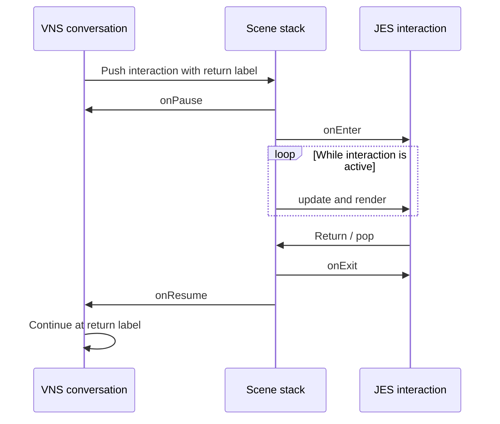

# Engine Lifecycle & Main Loop



> [!TIP]
> When a timer, sound, or animation continues unexpectedly behind a menu, inspect its owning scene’s pause/resume and exit behavior before adding another global flag.

**Module:** `modules/core` + `modules/runtime`  
**Core Class:** `Engine` (`com.jvn.core.engine`)  
**App Class:** `JvnApp` (`com.jvn.runtime`)  
**Purpose:** Coordinate scene management, frame timing, rendering, and input

---

## Overview

The **Engine** is the heart of JVN. It:
- Manages the scene stack (push/pop scenes)
- Drives the main loop (update → render → input)
- Coordinates all subsystems (graphics, audio, input, animation)
- Tracks frame timing and statistics

The **JvnApp** runtime currently launches supported Java 21 desktop integrations
(JavaFX, or Swing with `--ui swing`). Web, Android, and iOS modules are
non-deployable scaffolds and are not JvnApp launch targets.

---

## Engine Lifecycle

### 1. Initialization (startup)

```java
// Platform-specific (e.g., FX)
public class FxApp extends Application {
  private Engine engine;
  
  @Override
  public void start(Stage stage) {
    // 1a. Create config
    ApplicationConfig config = new ApplicationConfig("My Game", 1920, 1080);
    config.setTargetFps(60);
    config.setFullscreen(false);
    
    // 1b. Find renderer backend
    RendererRegistry registry = new RendererRegistry();
    RendererFactory factory = registry.get("JavaFX");
    
    // 1c. Create renderer + surface
    RenderConfig renderConfig = new RenderConfig(1920, 1080, stage);
    Renderer renderer = factory.createRenderer(renderConfig);
    
    // 1d. Create engine
    engine = new Engine(config, renderer);
    
    // 1e. Set initial scene
    engine.pushScene(new VnScene("intro"));
    
    // 1f. Start main loop
    engine.start();
  }
}
```

### 2. Running (steady state)

Main loop runs at target FPS (default 60):

```java
while (engine.isRunning()) {
  // Get delta time since last frame
  long frameStartMs = System.currentTimeMillis();
  double deltaMs = frameStartMs - lastFrameMs;
  lastFrameMs = frameStartMs;
  
  // Step 1: Update (logic)
  scene.update(deltaMs);
  engine.updateTweens(deltaMs);
  engine.updateAnimations(deltaMs);
  
  // Step 2: Render (graphics)
  Blitter2D blitter = renderer.getBlitter2D();
  scene.render(blitter, camera);
  renderer.present();
  
  // Step 3: Handle input
  InputSource input = surface.getInputSource();
  while (input.hasEvents()) {
    InputEvent event = input.nextEvent();
    engine.onInput(event);
  }
  
  // Step 4: Frame limiting
  long frameEndMs = System.currentTimeMillis();
  long frameTimeMs = frameEndMs - frameStartMs;
  if (frameTimeMs < msPerFrame) {
    Thread.sleep(msPerFrame - frameTimeMs);
  }
  
  // Step 5: Collect stats
  stats.recordFrameTime(frameTimeMs);
}
```

### 3. Shutdown (cleanup)

```java
engine.stop();
engine.dispose();  // cleanup resources
surface.close();   // close window
renderer.dispose();
System.exit(0);
```

---

## Core Classes

### Engine

**Location:** `modules/core/src/main/java/com/jvn/core/engine/Engine.java`

Central coordinator for all runtime systems.

```java
public class Engine {
  // Initialization
  public Engine(ApplicationConfig config, Renderer renderer);
  
  // Lifecycle
  public void start();           // begin main loop
  public void stop();            // gracefully exit
  public void dispose();         // free resources
  public boolean isRunning();    // check state
  
  // Scene management
  public void pushScene(Scene scene);      // add to top of stack
  public void popScene();                  // remove current scene
  public Scene getCurrentScene();          // get active scene
  public void replaceScene(Scene scene);   // pop + push (transition)
  
  // Update cycle
  public void update(double deltaMs);     // call once per frame
  public FrameStats getStats();           // FPS, frame time, etc.
  
  // Input delegation
  public void onInput(InputEvent event);  // mouse, key, gamepad
  
  // Subsystem access
  public Renderer getRenderer();
  public AudioManager getAudioManager();
  public AssetManager getAssetManager();
  public TimelineRunner getAnimationRunner(String id);
}
```

**Typical Usage:**

```java
// Create and configure
Engine engine = new Engine(config, renderer);

// Play intro VN scene
engine.pushScene(new VnScene("game/story/intro.vns"));

// (main loop runs until user quits)

// Transition to gameplay
engine.replaceScene(new JesScene2D("game/scenes/level1.jes"));

// Return to menu
engine.popScene();
engine.pushScene(new MainMenuScene());
```

---

### FrameStats

**Location:** `modules/core/src/main/java/com/jvn/core/engine/FrameStats.java`

Profiling and diagnostics; updated every frame.

```java
public class FrameStats {
  public double getFps();                    // frames per second
  public double getAverageFrameTimeMs();     // average frame duration
  public long getTotalFramesRendered();      // lifetime count
  public double getMemoryUsageMB();          // heap usage
  public int getActiveAnimationCount();      // running tweens/timelines
  public int getSceneStackDepth();           // how many scenes active
}
```

**Monitoring:**
```java
FrameStats stats = engine.getStats();
if (stats.getFps() < 55) {
  log.warn("Low FPS: {}", stats.getFps());
}
```

### ApplicationConfig

**Location:** `modules/core/src/main/java/com/jvn/core/config/ApplicationConfig.java`

Startup configuration.

```java
public class ApplicationConfig {
  public ApplicationConfig(String title, int width, int height);
  
  public void setTargetFps(int fps);        // default 60
  public void setFullscreen(boolean full);  // windowed vs full
  public void setVsyncEnabled(boolean vsync);
  public void setRenderer(String name);     // "JavaFX", "WebGL", "Android", etc.
  public void setInitialScene(String path); // .vns or .jes file
  
  // Getters for engine to read
  public int getTargetFps();
  public int getWidth();
  public int getHeight();
  // ... etc
}
```

---

## Scene Stack Model

Scenes are stacked (stack-based scene management):

```
┌─────────────────┐
│ Pause Menu      │ ← Current (updates, renders)
├─────────────────┤
│ Level 1 Gameplay│ (paused, not rendering)
├─────────────────┤
│ Main Menu       │ (paused)
└─────────────────┘
```

**Operations:**

```java
// Push (add scene on top)
engine.pushScene(pauseMenu);
// Stack: [menu, level1] → [menu, level1, pause]

// Pop (remove from top)
engine.popScene();
// Stack: [menu, level1, pause] → [menu, level1]

// Replace (pop + push)
engine.replaceScene(newLevel);
// Stack: [menu, level1] → [menu, newLevel]
```

**Only the top scene updates and renders.** Lower scenes are paused.

---

## Input Event Flow

Input travels from platform → Engine → current Scene:

```
RenderSurface (InputSource)
         ↓
   KeyDown: 'W'
         ↓
   Engine.onInput()
         ↓
   currentScene.onInput()
         ↓
   Scene processes (VNS choice handler, JES input binding, etc.)
```

**Example:**

```java
// VNS choice handling
public class VnScene extends Scene {
  @Override
  public void onInput(InputEvent event) {
    if (event.type == KeyDown && event.key == "ENTER") {
      // User confirmed choice
      vn.selectCurrentChoice();
    }
  }
}

// JES entity input
public class JesScene2D extends Scene {
  @Override
  public void onInput(InputEvent event) {
    if (event.type == MouseDown) {
      Entity2D clicked = findEntityAt(event.x, event.y);
      if (clicked != null) {
        clicked.onMouseDown(event);
      }
    }
  }
}
```

---

## Main Loop Timing

Frame budget at 60 FPS:

```
┌─────────────────────────────────┐
│ Frame (16.67 ms total)          │
├─────────────────────────────────┤
│ Update: 5 ms  ⟵ logic           │
│ Render: 10 ms ⟵ graphics        │
│ Input:  1 ms  ⟵ events          │
│ Sleep:  0.67 ms ⟵ frame limiting│
└─────────────────────────────────┘
```

If any step takes longer (e.g., render takes 12 ms), the frame still takes 16.67 ms but less time for next cycle.

**Drop frame if slow:**
```
Frame takes 25 ms (too slow)
  → FPS drops to 40
  → Engine logs warning
  → Consider optimization
```

---

## Extending Engine Behavior

### Custom Scene

```java
public class CustomScene extends Scene {
  @Override
  public void update(double deltaMs) {
    // Custom logic
    checkGameOverCondition();
    updateAI();
  }
  
  @Override
  public void render(Blitter2D blitter, Camera2D camera) {
    // Custom rendering
    renderGameWorld(blitter);
    renderHud(blitter);
  }
  
  @Override
  public void onInput(InputEvent event) {
    // Custom input handling
  }
}

// Use it
engine.pushScene(new CustomScene());
```

### Subsystem Integration

Access subsystems from any scene:

```java
// Audio
engine.getAudioManager().play("audio/bgm/theme.ogg", loop: true);

// Assets
Image img = engine.getAssetManager().load("assets/characters/hero.png");

// Animation
TimelineRunner runner = new TimelineRunner(timeline, accessor, 1.0);
engine.addAnimationRunner("hero_jump", runner);
```

---

## Lifecycle Hooks

Scenes can hook into lifecycle events:

```java
public abstract class Scene {
  // Called when scene becomes active
  public void onEnter() { }
  
  // Called when scene is paused (another pushed on top)
  public void onPause() { }
  
  // Called when scene is resumed (top scene popped)
  public void onResume() { }
  
  // Called when scene is being removed
  public void onExit() { }
  
  // Called when engine shuts down
  public void onDispose() { }
}
```

**Example:**

```java
public class GameScene extends Scene {
  private AudioHandle bgmHandle;
  
  @Override
  public void onEnter() {
    bgmHandle = engine.getAudioManager()
      .play("audio/bgm/gameplay.ogg", loop: true);
  }
  
  @Override
  public void onPause() {
    engine.getAudioManager().pause(bgmHandle);
  }
  
  @Override
  public void onResume() {
    engine.getAudioManager().resume(bgmHandle);
  }
  
  @Override
  public void onExit() {
    engine.getAudioManager().stop(bgmHandle);
  }
}
```

---

## Performance Profiling

Monitor frame stats to identify bottlenecks:

```java
FrameStats stats = engine.getStats();

// Per-frame
if (stats.getAverageFrameTimeMs() > 16.67) {
  log.warn("Frame time: {}ms (target 16.67ms)", 
    stats.getAverageFrameTimeMs());
}

// Memory
if (stats.getMemoryUsageMB() > 1000) {
  log.warn("High memory usage: {}MB", stats.getMemoryUsageMB());
}

// Active objects
if (stats.getActiveAnimationCount() > 100) {
  log.warn("Many animations: {}", stats.getActiveAnimationCount());
}
```

**Optimization Checklist:**
1. Reduce update complexity (fewer entities, simpler AI)
2. Batch render calls (fewer draw calls)
3. Reduce memory allocations (object pooling)
4. Profile with JProfiler or YourKit (Java)
5. Profile the supported JavaFX/Swing desktop runtime before changing frame or GC tuning

---

## Integration Examples

### Desktop (JavaFX)

```java
public class FxApp extends Application {
  private Engine engine;
  
  @Override
  public void start(Stage stage) {
    ApplicationConfig config = new ApplicationConfig("Game", 1920, 1080);
    RendererRegistry registry = new RendererRegistry();
    Renderer renderer = registry.get("JavaFX")
      .createRenderer(new RenderConfig(...));
    
    engine = new Engine(config, renderer);
    engine.pushScene(new VnScene("game/intro.vns"));
    engine.start();
  }
}
```

### Web and Mobile

There is no runnable GWT/TeaVM, Android, or iOS integration example today.
Those modules compile architectural scaffold classes on the JVM but do not
provide browser, APK/AAB, Xcode, app, or IPA outputs. Track their implementation
gates in the [platform status matrix](../../runtime/platforms/README.md).

---

## Related Documentation

- **System Architecture:** [docs/architecture/core/system-architecture.md](system-architecture.md) — where Engine fits
- **2D Engine:** [docs/architecture/core/2d-engine.md](2d-engine.md) — Scene2D and entities
- **Animation API:** [docs/scripting/timeline/animation/core-animation-api.md](../../scripting/timeline/animation/core-animation-api.md) — TimelineRunner details
- **Input System:** [docs/scripting/jes/systems/jes-input.md](../../scripting/jes/systems/jes-input.md) — input bindings in JES
- **Runtime:** [docs/runtime/core/runtime.md](../../runtime/core/runtime.md) — JvnApp wrapper

---

**Last Updated:** May 2026  
**Stability:** Core API, stable
