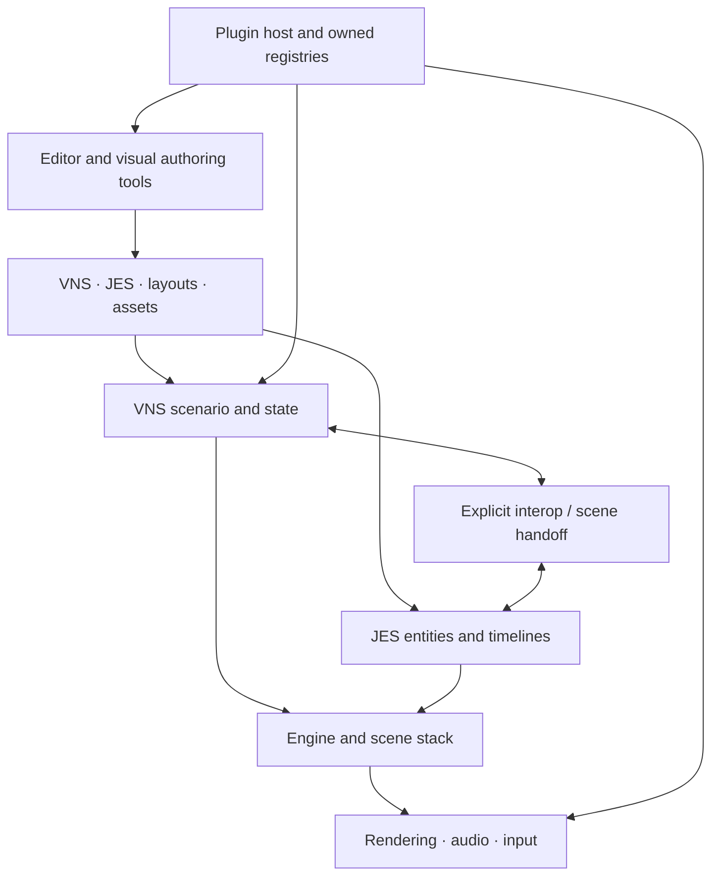

# Overview

> [!NOTE]
> An authoring tool writes project data; a runtime backend presents that data. Feature availability can differ by backend, so validate the platform you intend to ship.

JVN (Java Vector Nexus) is a Java game engine with a strong focus on visual novel production, scriptable 2D scenes, and editor-driven workflow.

This page is the high-level map. Use the linked docs for deeper implementation details.

## At a Glance

- **Narrative layer**: VNS (`.vns`) with labels, dialogue, branching, conditions, variables, transitions, audio, and interop commands.
- **Scene layer**: JES (`.jes`) for entities/components/input bindings/timelines in 2D scenes.
- **Runtime layer**: `JvnApp` wires engine, assets, interop, menu scenes, and renderer backend.
- **Authoring layer**: JavaFX editor for code + visual configuration editing.

## Main Workflow

1. Create/open a project in the editor.
2. Author story scripts in `scripts/story/*.vns`.
3. Configure dialogue/menu presentation in `config/ui` and `config/menu` as text DSL sources.
4. Preview scripts in editor and run full project via runtime.
5. Iterate with saves, settings, and timeline graph tools.

## Core Capabilities

### Engine Core

- **Engine** (`core/.../engine/Engine.java`): update loop with delta clamping, delta smoothing, optional fixed timestep
- **Scene stack** (`SceneManager`): push/pop/replace with `onEnter`/`onExit`/`onPause`/`onResume` lifecycle
- **Input** (`Input` + `InputCode`): backend-agnostic keyboard, mouse, and gamepad support with per-frame pressed/released tracking
- **TweenRunner**: lightweight time-based animation task runner, auto-removes finished tasks

### Visual Novel Runtime

- **Parser**: `VnScriptParser` — compiles `.vns` text to `VnScenario` with strict diagnostics
- **Runtime scene**: `VnScene` — drives node progression, character animation, screen effects
- **Interop**: `DefaultVnInterop` + runtime extension `RuntimeVnInterop` — 14 provider types
- **Save/load**: schema-based `VnSaveData`, migration layer, autosave slots, atomic writes

### 2D Scene Runtime

- **Entity system**: `Entity2D` with transform, parallax scrolling, z-order rendering
- **Camera**: `Camera2D` with exponential smoothing, bounds clamping, world↔screen transforms
- **Physics**: `PhysicsWorld2D` with gravity, broadphase spatial hashing, raycasts, collision/sensor callbacks
- **JES runtime**: tokenize → parse AST → load to `JesScene2D` with validated components
- **Timeline actions**: 22 action types for motion, camera, audio, calls, and flow control

### Menu Framework

- Dynamic profile loader from `config/menu/...`
- Configurable screens, layouts, styles, per-item actions, and inheritance
- Main/load/save/settings scenes all consume menu profiles

### Editor Tooling

- Code editors for VNS/JES/Timeline and general text formats
- Text-first layout/menu authoring with diagnostics, templates, and runtime validation
- VNS lint + quick fixes (undefined labels, missing assets, unreachable blocks)
- Timeline graph with validation and drag/drop script arc creation
- Puppeteer animation tool with keyframes, easing, audio cues
- Git version-control panel for team workflows
- Public documentation website and repository documentation index

## Project Requirements

- JDK 21
- Gradle wrapper (`./gradlew`)

## Recommended Docs Next

- [System Architecture](system-architecture.md) — modules, engine core, boot sequence, data flows
- [2D Engine](2d-engine.md) — Scene2D, entities, camera, physics, JES runtime
- [Runtime Guide](../../runtime/core/runtime.md) — CLI options, launch patterns, asset lookup
- [Editor Guide](../../editor/core/editor.md) — layout, editing modes, keyboard shortcuts
- [VNS Overview](../../scripting/vns/overview/vns-scripting.md) — VNS scripting language
- [JES Overview](../../scripting/jes/overview/jes-scripting.md) — JES scripting language
- [Menu Profiles](../../scripting/ui/menus/menu-profiles.md) — menu configuration system
