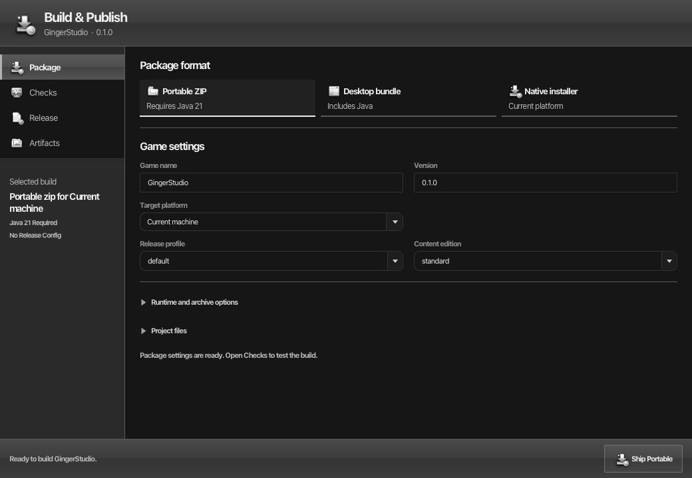

# Build workspace

Open the game, then choose **Build → Build & Publish...**. The workspace builds a distribution of the current game. Run the project once before packaging so you know its entry script and assets work together.

| Page | Use it for |
| --- | --- |
| **Package** | Choose the format and target. Check the project name, version, entry and configuration paths. |
| **Checks** | Scan dependencies and run selected checks. Open the source associated with a finding to correct a missing path. |
| **Release** | Inspect the plan for the release profile selected on Package. Check which signing, notarization or publish commands that profile configures before running it. |
| **Artifacts** | Inspect the output directory and generated artifacts. Check the command preview or copy it for a terminal build. |

## Package a test build

1. On **Package**, choose **Portable Zip** for a player with Java 21, or **Desktop Bundle** to include a runtime. Select the target operating system and architecture. **Native installer** uses `jpackage` on the current host.
2. On **Checks**, run the dependency scan. If a background is missing, check the path and capitalization in the declaration, fix the file or script, then scan again. Review unused media separately before removing anything.
3. Build the selected target. Follow the Gradle task in the Run workspace. The first desktop bundle for a target can take longer while JVN obtains its runtime.
4. On **Artifacts**, open the output and smoke-test a fresh extraction. Start a game, save, return to the title menu and load the slot. Test on the target operating system before distributing a cross-target bundle.

The default artifact directory is `build/distributions/games/` in the engine workspace. A configured `jvnBuildDir` changes the base directory. For Gradle commands, native formats and release profile keys, use the [build system reference](../../project-setup/release/build-system.md).

[Release checklist](../../project-setup/release/deployment.md) · [Run workspace](run-console.md)
