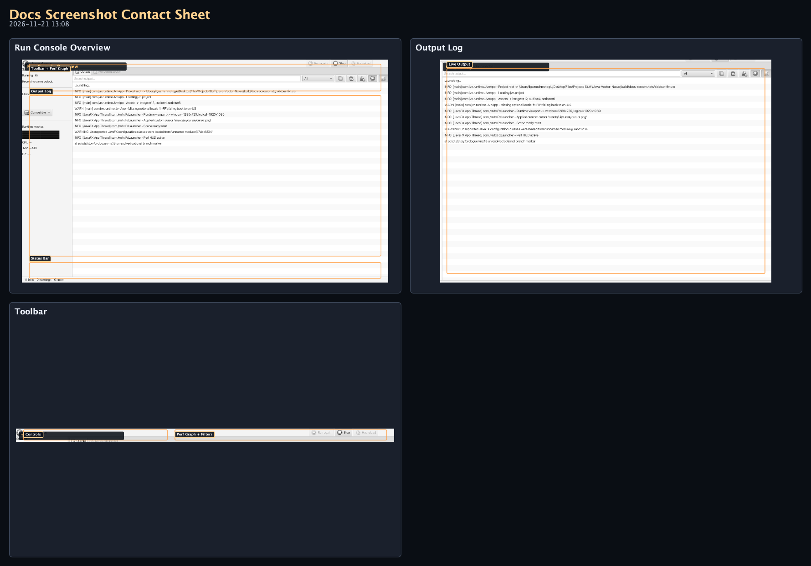
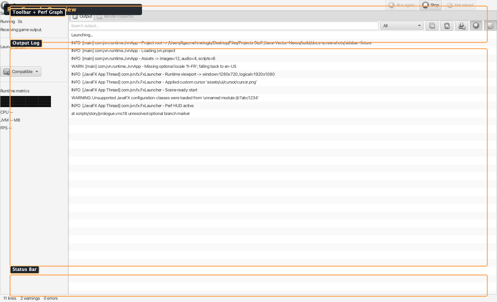
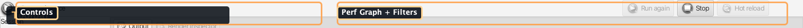
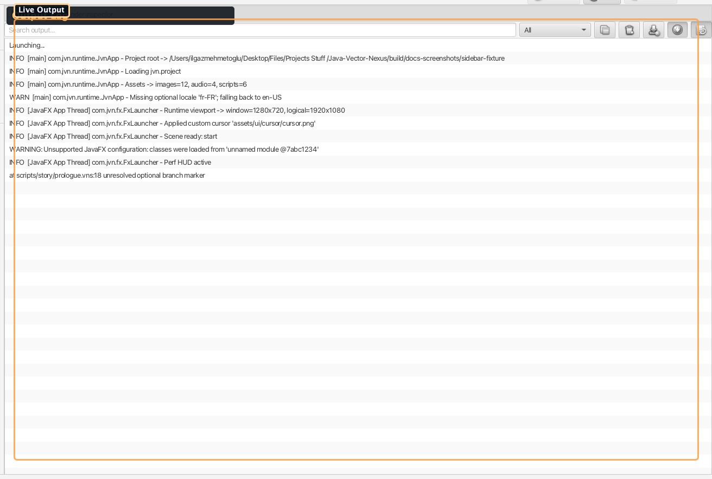

# Run Console Screenshots (Generated)

### Visual Reference (Auto-Generated)

_Generated by `./gradlew :editor:generateDocsScreenshots -Djvn.docs.profile=run-console` on 2026-11-21 13:08._

#### Contact Sheet

#### Run Console Overview

Toolbar, live output, performance graph, and status bar during a runtime launch.

#### Toolbar

Run controls, filters, search, and the compact runtime performance graph.

#### Output Log

Color-coded runtime output with warnings, info lines, and filtered Gradle noise.
