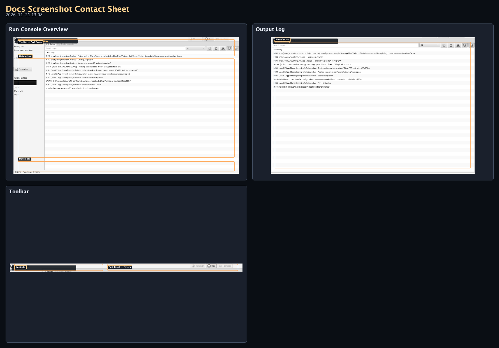
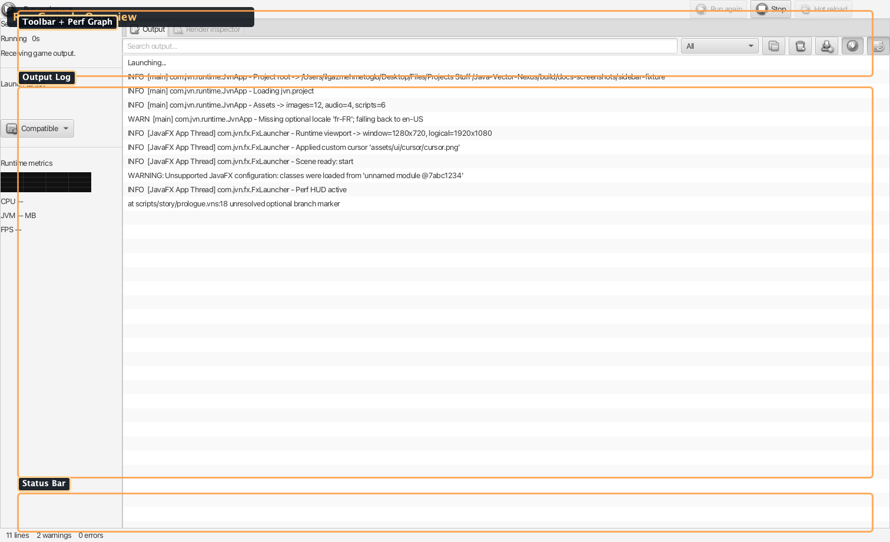
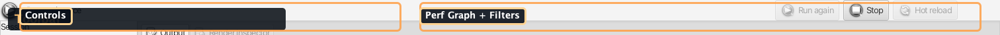
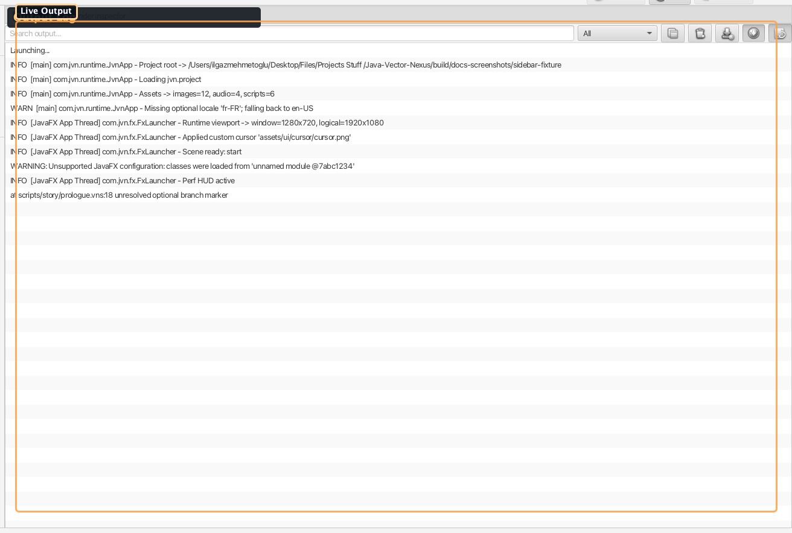

# Run workspace

Run a project from the editor to open the graphite **Run workspace**. Use **Output** to follow the launch and **Render inspector** to inspect the running game. Keep this window open while testing. Closing the runtime window stops the game process tree.

## Read a launch

The header identifies the workspace, task, elapsed time and launch state. Watch the activity line while Gradle builds and the runtime starts. If the process fails, switch the output filter to **Errors**. Turn on build output to inspect the Gradle lines around the first failure.

| Task | Control |
| --- | --- |
| Find a script or asset in the log | Search the output, then switch between **All**, **Engine**, **Errors** and **Warnings** to narrow the results. |
| Share a failure | Use **File → Copy Errors + Warnings** or **File → Save Log...**. |
| Inspect a frame | Open **Render inspector**. Check the frame and cache data after the game has rendered. **Capture asset inventory** requests a fresh inventory. |
| Compare a performance change | Run the same scene before and after your edit. CPU, JVM heap and FPS reflect samples reported by the game. A dash means there is no sample yet. |
| Test a correction | Use **Hot reload** where the running game supports it, or stop and re-run the project. |

## Gradle Launch Options

Open **Run → Gradle Launch Options** to change the next launch. The Fast Launch preset reuses the daemon, build cache and configuration cache, enables parallel work and caps Gradle at two workers. Compatibility uses a single-use daemon, disables configuration caching and parallel work, and selects the project-local Gradle home.

The editor and standalone launcher share `~/.jvn-editor/runtime-gradle.properties`. Changing a setting affects the next launch. A reused Gradle daemon may remain after the game stops.

## UI Layout

<!-- AUTO-RUN_CONSOLE-SCREENSHOTS:START -->
### Visual Reference (Auto-Generated)

_Generated by `./gradlew :editor:generateDocsScreenshots -Djvn.docs.profile=run-console` on 2026-11-21 13:08._

#### Contact Sheet

#### Run Console Overview

Toolbar, live output, performance graph, and status bar during a runtime launch.

#### Toolbar

Run controls, filters, search, and the compact runtime performance graph.

#### Output Log

Color-coded runtime output with warnings, info lines, and filtered Gradle noise.
<!-- AUTO-RUN_CONSOLE-SCREENSHOTS:END -->

[Editor guide](editor.md) · [Runtime arguments](../../runtime/core/runtime.md) · [Build workspace](build-workspace.md)
