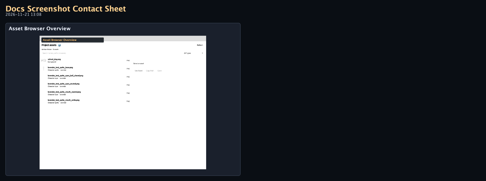
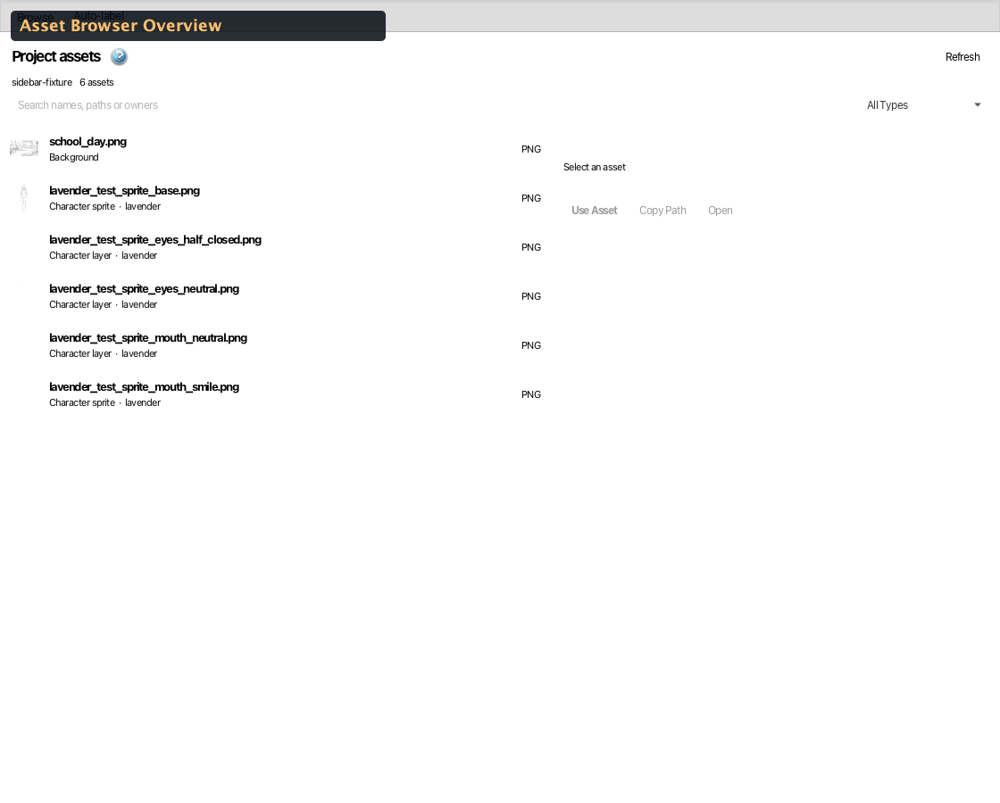

# Asset Browser

Open **Assets → Asset Browser**, or choose **Window → Open Tool Window → Asset Browser** for a separate window. Use **Browse** to find a file and **Auto-label** to review what it represents in the project. A narrow panel stacks the list and inspector. Widen it to compare them side by side.

## Find a file

Search for a filename, part of its project-relative path, a character ID or a saved label. The type filter accepts both formats and roles. For example, **Audio** includes music, voices and sound effects. **Voice** narrows that list to voice recordings. Searching for `ginger` also finds files whose VNS declaration names Ginger even when the filename omits her name.

Select a row to inspect the full path, format, size and role. Supported images show a fitted preview. Fonts supported by JavaFX show a sample in the selected typeface. Audio files readable by the installed decoder show available duration, sample rate and channel information.

| Action | Result |
| --- | --- |
| **Use Asset** | Sends the selected path to the active editor tool. In a VNS tab, place the cursor where the reference belongs. |
| **Copy Path** | Copies the project-relative path. |
| **Open** or double-click | Opens the file through the editor’s file handler or the system application. |
| Drag a row | Offers the path as text to a drop target. |
| **Refresh** | Rescans the project and reapplies filters. |

## Asset scanning

Browse walks `assets/`, `game/images/`, `game/audio/`, `game/fonts/`, `game/video/` and `game/ui/` up to 16 levels deep. The inventory also includes existing files referenced by visual declarations elsewhere in the project. Browse lists miscellaneous files, including font licenses. Auto-label inventories supported media and data files and can also report a missing declaration target.

## Auto-label Dashboard

Open **Auto-label** for the review queue. Select a file to see its suggested role, its owner when applicable, and the evidence behind the suggestion. **Save Label** stores an editor decision. **Generate VNS** writes a declaration for a role that supports one. For an example with a mixed folder, see [Review asset labels](../../tools/asset-label-review.md).

## UI Layout

<!-- AUTO-ASSET_BROWSER-SCREENSHOTS:START -->
### Visual Reference (Auto-Generated)

_Generated by `./gradlew :editor:generateDocsScreenshots -Djvn.docs.profile=asset-browser` on 2026-11-21 13:08._

#### Contact Sheet

#### Asset Browser Overview

Full Asset Browser sidebar utility view.
<!-- AUTO-ASSET_BROWSER-SCREENSHOTS:END -->

## Related docs

- [Project Explorer](../left/sidebar-project-explorer.md)
- [Layered Image Visualizer](sidebar-layered-image-visualizer.md)
- [Runtime asset paths](../../../runtime/systems/asset-management.md)
