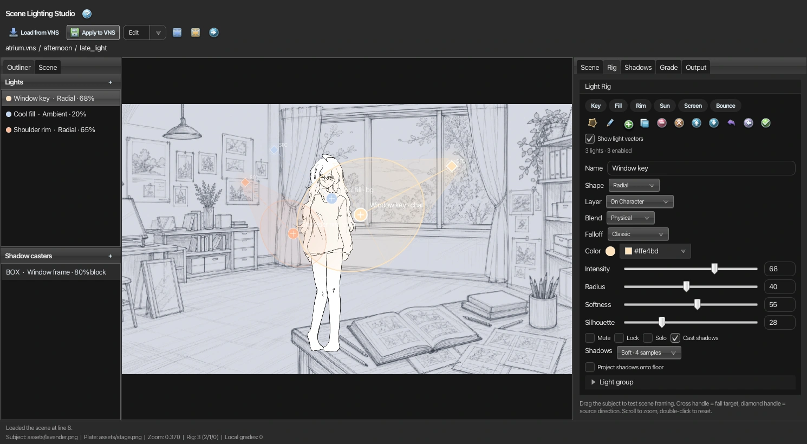
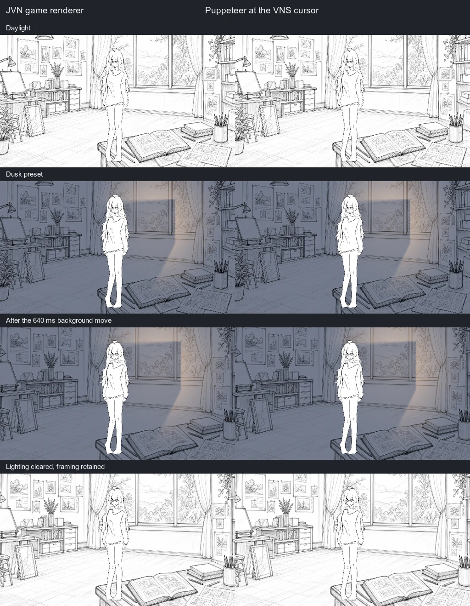

# Sidebar — Scene Lighting Studio

Scene-aware lighting and grading utility for character and background images. The tool supports staged light rigs, multiple light shapes, occlusion blockers, z-layered light passes, silhouette effects, reusable setups, and direct PNG/setup/stage export.

Source: `modules/editor/src/main/java/com/jvn/editor/ui/ImageTintToolView.java`

---

## Overview

Scene Lighting Studio is no longer just a simple tint slider panel. It behaves like a compact lighting and grading workspace:

- choose a character image and/or background image
- preview the composite live on a zoomable canvas
- apply global tint, saturation, and contrast
- add local grade zones for region-specific overrides
- place stationary scene lights that affect the character as you reposition it in the scene
- switch lights between radial, polygon, cone, strip, window, and bounce shapes
- stack lights behind the character, directly on it, or in front of it
- add silhouette strength so backlights can rim the character instead of only tinting the full body
- add occluders for shadow/blocker previews
- save reusable setups and export flattened PNGs, editor `.tintsetup` files, and runtime `.stagepreset` files with VNS/Puppeteer handoff metadata

- **Default side:** Right
- **Tab name:** Scene Lighting Studio
- **Implements:** `ImageToolPanel`
- **State file:** `.jvn/image-tint-tool.properties`

---

## UI Layout

<!-- AUTO-IMAGE-TINT-SCREENSHOTS:START -->
### Visual Reference (Auto-Generated)

_Generated by `./gradlew :editor:generateDocsScreenshots -Djvn.docs.profile=image-tint` on 2026-08-18 17:10._

#### Contact Sheet


#### Scene Lighting Studio Overview


Full tint tool workspace with preview canvas and controls sidebar.

#### Lighting Preview Canvas


Live composite preview with pan/zoom and zone drawing overlays.

#### Lighting Controls Sidebar


Tag/setup controls, global grade sliders, background grade, light rig, and local grade settings.
<!-- AUTO-IMAGE-TINT-SCREENSHOTS:END -->

---

## Workspace Structure

Open **Scene Lighting Studio** from Tools or Assets for a dedicated window. At widths of 1100 pixels and above, the left outliner lists lights and shadow casters. Its Scene tab contains the scene entities. Select a light or caster to open its inspector on the right. The same lists move into the inspector in a smaller window or docked sidebar. The viewport keeps a 16:9 frame.



| Viewport mode | Use |
| --- | --- |
| Edit | Move light handles and draw shapes. With the viewport focused, arrow keys nudge the selected light one viewport pixel. Hold Shift for ten pixels or Alt/Option to move the source. Locked lights stay in place. |
| Graded | Review the lighting with editing guides hidden. |
| Original | Review the source composition at the same framing. |
| Split | Drag across the viewport or use the comparison slider to reveal the original on the left and the graded result on the right. |

The background preview uses a smaller render while dragging a light or background-grade slider and restores its settled resolution on release.

### Try the lighting in a running scene

From the repository root, run the sample with the game renderer.

```sh
./gradlew :runtime:run --args="--assets '$PWD' --script scripts/examples/window-light/scene.vns"
```

Open `scripts/examples/window-light/scene.vns` in the editor and launch Puppeteer at each dialogue line. The example uses the bundled Lavender layers and studio background. Advance through daylight, the window-light preset, a 640 ms pan and zoom on the lit background, and the same framing after `[stage clear]`.



To regenerate the side-by-side frames and pixel differences, run the visual audit from the repository root on a machine with JavaFX display support.

```sh
JVN_PUPPETEER_AUDIT_ROOT="$PWD" \
JVN_PUPPETEER_AUDIT_SCRIPT=examples/window-light/scene.vns \
JVN_PUPPETEER_AUDIT_OUTPUT="$PWD/build/reports/window-light" \
JVN_PUPPETEER_AUDIT_STRICT=true \
./gradlew :editor:test --tests '*PuppeteerVisualParityAuditTest' --rerun-tasks
```

### Work directly from a VNS scene

1. Put the VNS cursor on a scene beat and click **Load from VNS**. The studio loads the background, available subjects, and active stage preset.
2. Choose a subject, arrange the rig, and check its shadows in the viewport.
3. Click **Apply to VNS** to write a `.stagepreset` beside the script in `lighting/` and activate it at the cursor. Applying directly on an existing studio-generated `[stage …]` line updates that preset. If the script already had unsaved changes, save it to persist the activation.

The scene still supplies its own background during gameplay. Standalone `.tintsetup` and `.stagepreset` files can be reopened through **Output → Import**.

### Tags & Setup

This section is for choosing what the tool is grading.

- **Character selector** — uses a character FX icon and loads a character image or charpreset-backed expression
- **Background selector** — uses a background FX icon and loads the background layer
- **Setup controls** — save, load, import, and delete named setups

The catalog is built from project assets plus script-declared character presets, so layered or preset-driven projects resolve correctly.

### Export

Export is a dedicated section, not mixed into setup controls.

The export area is mode-driven:

- **Lighting Profile** — clipboard-first export for quick sharing as a compact profile snippet
- **Setup** — editor-facing `.tintsetup`
- **Stage Preset** — runtime-facing `.stagepreset`

The selected mode drives the primary action buttons:

- **Copy Profile / Export Setup / Export Stage**
- **Export … As**
- **Quick target preview** so you can see exactly where the file will land before exporting

The export section also supports:

- **PNG** / **PNG As** — flattened graded image export
- **Setup** / **Setup As** — portable editor setup export
- **Stage** / **Stage As** — runtime-ready stage preset export
- **PNG + Setup + Stage** — one-click bundle export of all three outputs
- **Import** — load a `.tintsetup`
- **Choose Folder** / **Reveal** — manage the working export folder
- **custom naming**
- **auto naming from the current asset/setup**
- **persistent export directory**
- **selected export summaries** for PNG/setup/stage targets

### Stage Preset Handoff

Stage preset export is designed to be copied directly into the VNS/Puppeteer workflow. Exported `.stagepreset` files include:

- a stable `jvn.stagePreset.id`
- the source filename
- VNS declaration and activation hints
- light, occluder, and response-zone counts
- the full setup data needed by the runtime loader

Example header:

```properties
# JVN Stage Preset
# @stagepreset sunset_park config/stage/sunset_park.stagepreset
# [stage sunset_park]
jvn.stagePreset.schema=3
jvn.stagePreset.id=sunset_park
jvn.stagePreset.file=sunset_park.stagepreset
jvn.stagePreset.vnsDeclaration=@stagepreset sunset_park config/stage/sunset_park.stagepreset
jvn.stagePreset.vnsCommand=[stage sunset_park]
jvn.stagePreset.lightCount=3
jvn.stagePreset.occluderCount=1
jvn.stagePreset.responseZoneCount=4
```

Recommended handoff:

1. Export a stage preset from Scene Lighting Studio.
2. Add the generated `@stagepreset` declaration near the top of the `.vns` file.
3. Activate it with `[stage <id>]` before the beat you want to animate.
4. Open Puppeteer Launcher at that beat; it detects the active stage and carries it into Puppeteer.
5. Register/export the animation. Puppeteer includes stage metadata so reopening the timeline keeps the lighting context visible.

### Global Grade

Global grading affects the whole composite:

| Control | Description |
|---------|-------------|
| **Color** | Main tint color |
| **Strength** | Blend intensity toward the tint color |
| **Saturation** | Desaturate or oversaturate the image |
| **Contrast** | Flatten or sharpen tonal separation |

These changes are previewed live.

### Light Rig

Scene Lights are stationary light sources placed in the preview scene.

Each light has:

| Control | Description |
|---------|-------------|
| **Name** | Label for the light in the rig list |
| **Position** | Where the light falls on the scene (cross handle) |
| **Source** | Where the light originates from (diamond handle) |
| **Color** | Light tint color |
| **Intensity** | Brightness (0–100%) |
| **Radius** | Size of the light pool (5–80%) |
| **Softness** | Edge falloff (0–100%) |
| **Silhouette** | Rim/backlight contribution — high values rim the character instead of flat-tinting (0–100%) |
| **Shape** | Light type (see below) |
| **Layer** | Z-layer: `background`, `character`, or `foreground` |
| **Group** | Name a cluster, then mute or solo its lights together |
| **Blend** | Physical, Normal, Add, Screen, Multiply, Overlay, or Soft Light |
| **Falloff** | Classic, linear, smooth, or a bounded inverse-square curve |
| **Beam Angle / Area Width** | Spotlight aperture in degrees, or the width-to-length ratio of an Area or Window light |
| **Cast shadows** | Include or exclude occlusion for this light |
| **Shadow sampling** | Hard edges, four-ray soft shadows, or eight-ray soft shadows |
| **Mute** | Suppress light contribution without removing it |
| **Lock** | Prevent accidental dragging on the canvas |
| **Solo** | Show only this light, hiding all others temporarily |

The key idea is scene-relative behavior: when you move the character around the preview, the character grading reacts to those lights instead of the light moving with the character. This makes the tool useful for staging VN shots with fixed lamps, windows, signs, firelight, and similar environmental lighting.

#### Light Shapes

| Shape | Description |
|-------|-------------|
| **Radial** | Soft general-purpose pools |
| **Polygon** | Hand-drawn or freehand projected areas |
| **Cone** | Directional beams or key lights |
| **Strip** | Thin edge lights, monitors, or tube lights |
| **Window** | Broad rectangular light patches |
| **Bounce** | Reflected light from floor or wall surfaces |
| **Area** | An oriented oval whose width can be adjusted |
| **Directional** | Full-stage light with parallel shadow rays |
| **Ambient** | Uniform fill across the stage |

#### Quick-Add Light Presets

The rig section provides one-click preset chips for common lighting roles:

| Preset | Shape | Layer | Description |
|--------|-------|-------|-------------|
| **Key** | Cone | Character | Primary subject light, warm, upper-right |
| **Fill** | Radial | Character | Soft blue fill from the left side |
| **Rim** | Strip | Foreground | Warm backlight/edge light from behind-right |
| **Sun** | Window | Background | Broad warm patch for outdoor/window light |
| **Screen** | Strip | Foreground | Cool blue glow simulating monitor/screen spill |
| **Bounce** | Bounce | Character | Warm upward bounce from floor/wall |

Presets are starting points — all properties are fully editable after placement.

By default, the preview also shows the light vector for each scene light:

- **Cross handle** — where the light is falling onto
- **Diamond handle** — where the light is coming from
- **Beam / footprint preview** — a shape-aware visualization of how the light projects into the scene

Use **Show light vectors** to hide or reveal the guides, and **Reset selected light source vector** to snap the source handle back to its default upper-left staging position for the selected light.

#### Drawing Modes

Lights can be added via:

- **Default** — click "Add" to place a generic light at center
- **Polygon draw** — click on the preview to nail vertices; click near the first point or double-click to close a polygon light shape
- **Freehand draw** — hold and drag to sketch a smoothed polygon light shape

### Occlusion

Occlusion adds shadow blockers on top of the light rig.

Use occluders for:

- window-frame cut shadows
- doorway or pillar blockers
- gobos and beam masks
- coarse subject / plate shadow separation while staging

Each occluder has:

| Control | Description |
|---------|-------------|
| **Name** | Label for the occluder in the list |
| **Block %** | Shadow opacity (0–100%) |
| **Softness** | Edge falloff for the blocker (0–100%) |
| **Enabled** | Toggle the occluder on/off without removing it |

Use **Draw Box** or **Draw Ellipse** and edit the normalized bounds as percentages in the Shadows tab. Use the polygon or freehand tools when the object silhouette matters. **Import Mask** traces the alpha channel of a transparent PNG or the white areas of a grayscale PNG. The mask should have the same framing as the stage. Connected solid regions create separate polygon casters.

The Shadows tab can display solid outlines, sampled rays, blocked-light coverage, or both diagnostics together. Pink areas show which portions of the selected light are blocked. Opacity controls how much light the caster blocks and penumbra controls the width of soft edges.

For a painted room with a floor, turn on **Project shadows onto floor** in the selected light. Set the point below the light, the horizon and shadow strength. Floor Light controls the illumination on the receiver plane, and Floor Exposure controls the floor independently of the sky. In the Shadows tab, set each object's floor contact and height scale. Floor depth can give flat silhouettes volume. For a rigid prop, enter a floor Y for each contour vertex to give its corners distinct depths. Shadow Fade reduces opacity toward the end of a long floor cast. Shadow Framing allows an optional offset, scale and angle correction for a painted reference. Use **Round floor shadow** for a sphere. The projection preserves the painted artwork over the projected shadow.

Object Exposure and Object Contrast grade a segmented object on a flattened background. Use them to preserve painted material detail while changing the stage exposure.

### Subject material

Use **Grade → Subject Material** to attach a tangent-space RGB normal map to the selected sprite. Use the same framing as the artwork. Normal Strength controls directional relief, Specular controls reflected highlights, and Gloss changes highlight width. The material and caster geometry are saved with the rig.

### Headless preview and mask tracing

```sh
./gradlew :fx:renderStageLighting --args='plate.png rig.stagepreset lit.png silhouettes.png shadow-debug.png'
./gradlew :fx:renderStageLighting --args='--segment caster-mask.png casters.stagepreset 128 0.8'
```

The headless preview applies the gameplay background-lighting pass to a flattened plate. The two debug PNGs are optional. Floor-projection diagnostics show the footprint of the light and projected rays. Mask tracing accepts a coverage threshold from 1 to 255 and contour simplification tolerance in source pixels. Preset caster polygons and `bounds=x,y,width,height` use normalized stage coordinates with the origin at the upper-left.

### Background Grade

Background Grade applies plate-side adjustments independently of the subject lighting flow. Use it for atmospheric grading on the scene plate without having to flatten everything into one destructive pass first.

| Control | Description |
|---------|-------------|
| **Tint Color** | Background tint color |
| **Tint Strength** | Blend intensity toward the tint color |
| **Tint Blend** | Blend mode for the tint pass |
| **Saturation** | Desaturate or oversaturate the background |
| **Contrast** | Flatten or sharpen tonal separation |
| **Overlay Color** | Secondary overlay color (e.g., dark vignette or atmosphere) |
| **Overlay Opacity** | Overlay blend strength |
| **Overlay Blend** | Blend mode for the overlay pass |

#### Blend Modes

Both tint and overlay support these blend modes (also used by Local Grades):

`Normal`, `Multiply`, `Screen`, `Overlay`, `Soft Light`, `Hard Light`, `Color Dodge`, `Color Burn`, `Difference`, `Exclusion`, `Lighten`, `Darken`, `Add`, `Subtract`

### Local Grades

Zones are polygonal local tint regions drawn directly on the preview.

Typical use cases:

- warm window light on one side of a sprite
- cold top-down light only on hair/shoulders
- colored signage spill on a coat or face
- localized atmosphere patches on the background

Zones are also where you can push more selective response for different regions instead of treating the subject as one flat material.

#### Per-Zone Controls

| Control | Description |
|---------|-------------|
| **Name** | Label for the zone in the list |
| **Color** | Zone tint color |
| **Strength** | Tint intensity (0–100%) |
| **Saturation** | Local saturation adjustment (-100–100%) |
| **Contrast** | Local contrast adjustment (-100–100%) |
| **Feather** | Edge softness / falloff (0–100%) |
| **Rotation** | Rotation angle for rectangular zones (-180–180°) |
| **Blend** | Blend mode (same 14 modes as Background Grade) |
| **Surface** | Material surface class (see below) |
| **Depth** | Depth bias for zone ordering (-100–100%) |
| **Response %** | Light response scale — how strongly the zone reacts to scene lights (10–250%) |

#### Surface Classes

Each zone can be tagged with a surface class that hints at material-aware light response:

| Surface | Description |
|---------|-------------|
| **Default** | Generic / unclassified |
| **Skin** | Skin tones — warm subsurface response |
| **Hair** | Hair — anisotropic highlight behavior |
| **Fabric** | Clothing and textiles |
| **Metal** | Metallic / reflective surfaces |
| **Glass** | Transparent / refractive surfaces |

#### Drawing Modes

Zones can be created via three methods:

- **Rectangle drag** — drag on the preview to draw a rectangular zone
- **Polygon draw** — click to nail vertices; click near start or double-click to close
- **Freehand draw** — hold and drag to sketch a smoothed freehand zone

Zones can be reordered with move-up / move-down buttons, and each zone's overlay bounds can be toggled visible/hidden independently.

---

## Preview Canvas

The preview canvas composites:

1. selected background
2. selected character
3. global tint adjustments
4. scene-light contribution
5. occlusion and blocker contribution
6. background grade
7. local grade effects

Supported interactions:

| Interaction | Result |
|-------------|--------|
| **Drag** | Pan the preview |
| **Scroll** | Zoom in/out |
| **Double-click** | Reset view |
| **Drag subject** | Reposition the subject relative to the scene lights |
| **Drag cross handle** | Move the selected light target and keep the source offset aligned |
| **Drag diamond handle** | Adjust where the light is coming from without moving its fall target |
| **Light drawing gestures** | Draw polygonal or freehand light shapes |
| **Occluder gestures** | Draw polygonal or freehand shadow blockers |
| **Local grade gestures** | Draw and adjust polygon grade zones |

The status line reports the active asset selections, zoom, zone count, and light count.

---

## Saved Setups and Files

Three persistence layers are used:

- **Named saved setups** in `.jvn/image-tint-tool.properties`
- **Portable `.tintsetup` files** for export/import and sharing between editors
- **Portable `.stagepreset` files** for runtime-facing stage export

A setup stores:

- character/background selection
- global tint values (color, strength, saturation, contrast)
- background grade values (tint, overlay, blend modes)
- scene lights (all properties including muted/locked/solo/group, polygon shapes)
- occluders (all properties including enabled state, polygon shapes)
- tint zones (all properties including surface class, depth bias, response scale, polygon shapes)
- view and export preferences (zoom, pan, export folder)

---

## State Persistence

Persisted state includes:

| State | Persisted |
|-------|-----------|
| Selected character/background | ✓ |
| Global tint values | ✓ |
| Background grade values | ✓ |
| Scene lights | ✓ |
| Occluders | ✓ |
| Tint zones | ✓ |
| Saved setups | ✓ |
| Export folder + naming mode | ✓ |
| Preview zoom/pan | ✓ |
| Sidebar width/collapsed state | ✓ |
| Section expand/collapse state | ✓ |

---

## Typical Workflow

1. Pick a background and character in **Tags & Setup**
2. Rough in global grading in **Global Grade**
3. Add 1-3 stationary lights in **Light Rig**
4. Add **Occlusion** blockers if the scene needs shaped shadows
5. Move the character until the lighting reads correctly
6. Add **Local Grades** patches for local corrections
7. Save a named setup
8. Export either a **Lighting Profile**, **Setup**, **Stage Preset**, or **PNG + Setup + Stage** bundle depending on the handoff you need

---

## Related Docs

- [Sidebar Utilities Overview](../overview/sidebar-utilities.md) — all sidebar panels
- [Layered Image Visualizer](sidebar-layered-image-visualizer.md) — layer-based sprite composition and export
- [Image Attributes Tool](sidebar-image-attributes-tool.md) — attribute-driven image assembly
- [Asset Browser](sidebar-asset-browser.md) — general asset discovery
- [VNS Directives — @stagepreset](../../../scripting/vns/language/vns-directives.md#stagepreset-stage-lighting-preset) — loading exported presets in VNS scripts
- [VNS Commands — stage](../../../scripting/vns/language/vns-commands.md#stage-lighting) — activating stage presets at runtime
- [Puppeteer Launcher](sidebar-puppeteer-launcher.md) — carrying active stage context into animation authoring
