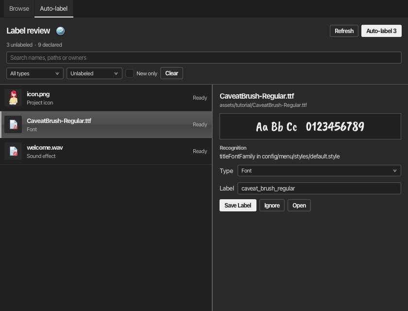

# Review asset labels

Use **Assets → Auto-label Assets...** or the **Auto-label** tab in the Asset Browser. Start with **Unlabeled**, select a file, and read **Recognition** above its editable fields. **Ready** means the evidence reached the editor’s 80% threshold. **Review** means you decide whether the role and owner fit.



## Work through a mixed folder

In GingerTutorial, select `welcome.wav`. Its extension establishes that it is audio. The `[sfx]` command that references it establishes its role as a sound effect. The font inspector can identify `CaveatBrush-Regular.ttf` from the menu’s `titleFontFamily` setting. The game icon has its own role too. These three labels are editor metadata.

For character art, compare these declarations with the files beside them.

```vns
@character ginger "Ginger"
@charimg ginger neutral assets/art/face.png
@charlayer ginger eyes_open assets/art/ginger_eyes_open.png
@background kitchen assets/art/kitchen.png
```

The declarations assign `face.png` and the eyes to Ginger even though the first filename has no character name. A new `GingerThoughtful.png` suggests a full pose. A new `gingerEyesClosed.png` suggests a component layer. An unrelated `plate.png` in the same mixed directory needs more evidence before you give it an owner.

The labeler checks literal script and configuration references, character IDs, naming patterns, compatible declared siblings and byte-identical artwork. An identical copy used by different characters and audio used both as music and as an effect can need review. Inspect the source named in **Recognition** when ownership matters.

## Choose what to save

| Action | What changes |
| --- | --- |
| **Save Label** | Records the reviewed type, owner and label in `.jvn/asset-labels.properties`. |
| **Generate VNS** | Writes the visual declaration to `scripts/definitions/auto_labels.vns` and connects it to the entry script. Open **VNS declaration** to inspect or copy the line first. |
| **Auto-label** | Applies the ready suggestions across the inventory. It generates VNS for declarable roles and saves editor labels for the others. The count on the button covers the entire queue, including rows hidden by filters. |
| **Ignore** | Records that decision. Select the ignored state in the filter to find the file again. |

A **Background** generates `@background`. A **Character sprite** generates `@charimg`. Character layers, props, comic panels, UI art and visual effects use `@charlayer` with a character or object ID. A voice can have a character owner while remaining an editor label.

## Missing files, conflicts and imports

A missing row carries the path and source of the declaration. Restore the file at that path or edit the declaration to point to the intended asset. A conflict means a scoped label points at different files. Check both references before choosing a distinct label or correcting the path. Several aliases for one file are supported.

Drop supported files on the editor to review the detected roles. External files are copied into a proposed project asset folder when you confirm the import. Review the imported result, especially if its source folder used different character names.

[Browse assets](../sidebars/right/sidebar-asset-browser.md) · [VNS declarations](../../scripting/vns/language/vns-directives.md)
