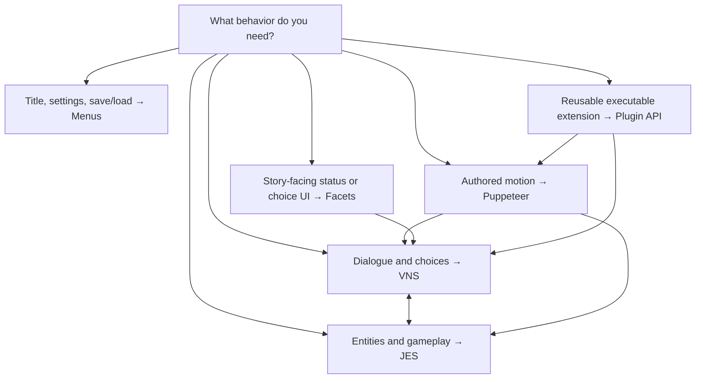

# Choose Your Path in JVN

> [!TIP]
> Combine layers at explicit boundaries. A VNS scene can push a JES interaction and resume at a label; a plugin can add an image effect without owning the story or window.

If you are new to JVN, the biggest early mistake is starting in the wrong layer. This page tells you which part of the engine to use first.

## The Short Version

- Use **VNS** for story flow, dialogue, choices, character staging, and most visual novel logic.
- Use **JES** for gameplay scenes, entities, components, physics, camera systems, and lower-level scene control.
- Use **Puppeteer** for authored timeline animation that should be previewed visually and then reused from VNS or JES.
- Use **Scene Lighting Studio** when a shot needs reusable lighting, background grading, occluders, or stage presets that should carry into VNS and Puppeteer.
- Use **Menu Profiles + Layouts** for title screens, settings, save/load, and textbox/menu presentation.
- Use the **Editor sidebar tools** for supporting workflows such as diagnostics, layered character inspection, scene lighting, or menu flow.

## When To Start With VNS

Start with VNS if your first goal is:

- show a background
- show a character
- play dialogue
- branch with choices
- set variables and flags
- call a minigame, timeline, or Java hook only when needed

Read next:

- [VNS Overview](../scripting/vns/overview/vns-scripting.md)
- [Tutorial: Building a Complete VN](../scripting/vns/guides/vns-tutorial.md)

## When To Start With JES

Start with JES if your first goal is:

- build a gameplay scene
- manage entities and components directly
- use tilemaps, physics, AI, or input bindings
- run a 2D scene without the VN layer driving it

Read next:

- [JES Overview](../scripting/jes/overview/jes-scripting.md)
- [Scenes & Entities](../scripting/jes/scene/jes-scenes-entities.md)

## When To Start With Puppeteer

Start with Puppeteer if your first goal is:

- animate a character entrance or exit
- time a camera move or cut
- coordinate multiple properties on a timeline
- preview motion before exporting it
- build reusable timeline clips
- preserve lighting context from an active VNS stage preset while animating

Read next:

- [Puppeteer Overview & Architecture](../editor/puppeteer/puppeteer.md)
- [Puppeteer Editor Guide](../editor/puppeteer/puppeteer-editor-guide.md)

## When To Start With Scene Lighting Studio

Start here if your first goal is:

- grade a character/background composite
- build reusable scene lights or shadow blockers
- export `.stagepreset` files for VNS `[stage ...]`
- make Puppeteer launch with the same lighting setup as the script beat

Read next:

- [Scene Lighting Studio](../editor/sidebars/right/sidebar-image-tint-tool.md)
- [VNS Directives & Declarations](../scripting/vns/language/vns-directives.md#stagepreset-stage-lighting-preset)

## When To Start With Menu Profiles And Layouts

Start here if your first goal is:

- build the main menu
- customize save/load/settings screens
- restyle the dialogue textbox
- define project UI in plain config files

Read next:

- [UI By Example](ui-by-example.md)
- [Menu Profiles Overview](../scripting/ui/menus/menu-profiles.md)
- [Text-First Layout Workflow](../scripting/ui/layout/workflow/text-first-layout-workflow.md)

## Common Beginner Combinations

### Standard visual novel

Use:

- VNS for story
- menu/layout docs for UI
- Puppeteer only for special staged animation

### VN with minigames or playable scenes

Use:

- VNS for story flow
- JES for gameplay scenes
- Puppeteer for cinematic animation inside either layer

### UI-heavy title screen or custom shell

Use:

- menu profiles
- layouts and styles
- Facets or reactive screens for story-bound overlays
- VNS only once the player enters story content

## If You Are Unsure

Start with this order:

1. [Getting Started Guide](getting-started.md)
2. [Common JVN File Types](common-file-types.md)
3. [VNS Overview](../scripting/vns/overview/vns-scripting.md)

That path is the safest default for most teams building a VN in JVN.
