# Getting Started with JVN

> [!NOTE]
> **Prerequisite:** JDK 21 and a source checkout. **First result:** a project you can run, with an editable script and a known entry point. Choose Tutorial Workspace for the full 30-lesson course.

```mermaid
flowchart LR
  accTitle: From checkout to a playable project
  accDescr: Build the engine, open the editor, create a project, edit a scene, preview it, then test the full runtime before packaging.
  A["Get source and JDK 21"] --> B["Build / open editor"]
  B --> C["Create Tutorial Workspace"]
  C --> D["Edit a VNS scene"]
  D --> E["Preview the scene"]
  E --> D
  E --> F["Run the whole project"]
  F --> G["Validate and package"]
```



**Checkpoint:** reach the workshop hub, open a lesson’s source, change one line, and see that change in the running project. A preview verifies the current scene; a full run also verifies menus, project entry, and runtime integration.

This guide walks you through building JVN, creating your first project, and running it.

Before you go deep:

- not sure whether you should start in VNS, JES, Puppeteer, or menus: [Choose Your Path in JVN](choose-your-path.md)
- not sure what the main files are yet: [Common JVN File Types](common-file-types.md)

---

## Prerequisites

- **JDK 21** — toolchain auto-download is enabled, but a local JDK 21 is recommended
- **No global Gradle install required** — `./jvnw` is the default command wrapper, with `./gradlew` available for advanced tasks
- **Git** (optional) — for version control integration in the editor

Before launching the editor, run the shell-only health check:

```bash
./jvnw doctor
```

It checks Java/JDK availability, `JAVA_HOME`, the Gradle wrapper, module checkout, cache permissions,
and host-shell compatibility without starting the editor. Use its corrective guidance as the primary
replacement for GUI environment-health tooling.

### Why There Is No Prebuilt Download Yet

JVN is currently a source-first project. There are no official prebuilt editor or engine binaries for the preview line, so the supported way to run it is from a cloned repository:

- use `./jvnw <command>` for builds, tests, editor/runtime launches, and packaging tasks
- use the Engine Hub (`./jvn` on macOS/Linux, `jvn.bat` on Windows) for the desktop workflow, shortcut installation, updates, and common build actions

This avoids stale binaries during a period where the engine, editor, templates, and file formats are still changing. The wrapper and hub always operate on the checkout in front of you, using the matching Gradle wrapper, classpath, generated resources, and Java toolchain.

Official prebuilt binaries are planned for the first major JVN release, currently expected by the end of 2026. From that release onward, users should be able to install or download JVN without cloning and building the engine first.

---

## Step 1: Build the Engine

Clone the repository and build:

```bash
git clone <repository-url> Java-Vector-Nexus
cd Java-Vector-Nexus
./jvnw build
```

This compiles all modules and runs tests.

### Targeted builds during development

Instead of full `build` every time, use focused tasks:

```bash
# Default wrapper commands
./jvnw build
./jvnw test

# Optional direct Gradle tasks for focused module work
./gradlew :core:compileJava :runtime:compileJava
./gradlew :editor:compileJava
./gradlew :core:test :scripting:test
```

---

## Step 2: Launch the Editor

For day-to-day work, start with the Engine Hub:

```bash
# macOS / Linux
./jvn
```

```bat
:: Windows
jvn.bat
```

The hub can launch the editor, run builds/tests, update the engine checkout, and install desktop shortcuts. Click **Build Shortcuts** to create a native OS launcher for this checkout.

Installed shortcuts launch without opening a terminal or command prompt:

| OS | Shortcut location |
|----|-------------------|
| macOS | `~/Applications/JVN Engine Hub.app` |
| Linux | Applications menu entry from `~/.local/share/applications/jvn-engine-hub.desktop` |
| Windows | Start Menu and Desktop shortcuts |

If a shortcut launch fails, check the platform log listed in [JVN Engine Hub](../editor/core/engine-hub.md).

You can also launch the editor directly:

```bash
./jvnw editor
```

The editor startup preflight checks the workspace, Gradle wrapper, writable state path, Java runtime, and other basic health indicators before launch.

The editor opens with a Welcome dashboard showing:
- Recent projects
- Environment health checks
- Quick actions: **New Project**, **Open Project**

---

## Step 3: Create a New Project

1. Click **New Project** in the Welcome dashboard.
2. Fill in project basics (name, author, location).
3. Choose engine profile (resolution, menu theme).
4. Select feature modules (sample script, menu profiles, save/load).
5. Optionally enable Git version control.
6. Review the generated layout preview.
7. Click **Create**.

The wizard generates a complete project scaffold:

```text
MyProject/
├── config/
│   ├── settings/vn.settings
│   ├── story/story.storymap
│   ├── ui/dialogue.layout
│   └── menu/
│       ├── registry/menu.registry
│       ├── menus/{main,load,save,settings}.menu
│       ├── layouts/default.layout
│       └── styles/default.style
├── scripts/
│   └── story/prologue.vns
├── assets/
│   ├── backgrounds/
│   ├── characters/
│   └── audio/{bgm,sfx,voices}
├── jvn.project
└── README.md
```

---

## Step 4: Edit Your First Script

Open `scripts/story/prologue.vns` from the project explorer. You'll see a starter script:

```vns
@scenario prologue
@character narrator "Narrator"

@label start
narrator: Welcome to your new visual novel!
[end]
```

Try adding content:

```vns
@scenario prologue
@character narrator "Narrator"
@character hero "Aria"
@background park assets/backgrounds/park.png
@charimg hero neutral assets/characters/aria/neutral.png
@charimg hero happy assets/characters/aria/happy.png

@label start
[bg park]
[bgm assets/audio/bgm/calm.ogg]
[show hero center neutral]

narrator: A new day begins.
hero: Hello! I'm Aria.

[show hero center happy]
hero: Nice to meet you!

> Tell me more -> learn_more
> Let's get going -> adventure

@label learn_more
hero: I love exploring and meeting new people!
[jump adventure]

@label adventure
narrator: And so the adventure begins...
[end]
```

The editor provides:
- **Syntax highlighting** for VNS
- **Real-time diagnostics** (undefined labels, missing assets)
- **Quick fixes** via context menu on diagnostic markers

---

## Step 5: Run Your Project

Click the **Run** button at the top of the Project Explorer panel.

Or run from terminal:

```bash
./jvnw runtime --args='--assets /path/to/MyProject --script scripts/story/prologue.vns --ui fx --audio auto'
```

### Runtime Controls

| Key | Action |
|-----|--------|
| **Enter / Click** | Advance dialogue / complete text reveal |
| **1-9** | Select choice option |
| **S** | Toggle skip mode |
| **A** | Toggle auto-advance |
| **H** | Hide/show UI |
| **L** | Open history/backlog |
| **Ctrl+S** | Quick save |
| **Ctrl+L** | Quick load |
| **Esc** | Open menu |

---

## Step 6: Configure Presentation

### Dialogue Layout

Open `config/ui/dialogue.layout` in **Layout Studio**. Start with a commented template if useful,
edit textbox, name, text-padding, and choice properties directly, and use the asset utilities for
custom skins. Resolve diagnostics and run the project to see the authoritative result.

### Menu Screens

Open files under `config/menu/menus/` in Layout Studio to edit items, actions, targets, and
layout/style references. Use **Save and Run Runtime** to test presentation and navigation.

### Menu Styles

Open `config/menu/styles/default.style` to customize colors, fonts, and prefixes.

---

## Step 7: Add Assets

Place your assets in the project's `assets/` directory:

```text
assets/
├── backgrounds/       # scene backgrounds
│   ├── classroom.png
│   └── forest.png
├── characters/        # character sprites
│   └── aria/
│       ├── neutral.png
│       ├── happy.png
│       └── angry.png
├── audio/
│   ├── bgm/          # background music
│   ├── sfx/          # sound effects
│   └── voices/       # voice clips
├── ui/                # UI elements
└── fonts/             # custom fonts
```

Reference them in your VNS scripts:

```vns
@background classroom assets/backgrounds/classroom.png
@charimg hero neutral assets/characters/aria/neutral.png
[bgm assets/audio/bgm/school_theme.ogg]
[sfx assets/audio/sfx/door_open.ogg]
```

---

## Step 8: Use the Timeline Graph

Open `config/story/story.storymap` to see the narrative structure graph.

- Each **arc** represents a VNS script file and entry label
- **Links** show how arcs connect (branches, returns)
- Drag `.vns` files from the project explorer onto the graph to create arcs
- Use clusters to organize main story vs. side content

---

## Next Steps

- **[Choose Your Path in JVN](choose-your-path.md)** — decide which JVN layer to learn next
- **[Common JVN File Types](common-file-types.md)** — understand what each file controls
- **[VNS Scripting Guide](../scripting/vns/overview/vns-scripting.md)** — complete language reference
- **[Cookbook & Recipes](cookbook.md)** — common patterns and examples
- **[Editor Guide](../editor/core/editor.md)** — full editor features
- **[Menu Profiles](../scripting/ui/menus/menu-profiles.md)** — customizing menus
- **[Save System](../runtime/systems/save-system.md)** — save/load architecture
- **[Puppeteer Animation Editor](../editor/puppeteer/puppeteer.md)** — visual keyframe animation
- **[Scene Lighting Studio](../editor/sidebars/right/sidebar-image-tint-tool.md)** — reusable scene lighting and stage preset export
- **[Documentation Index](../INDEX.md)** — full docs map
