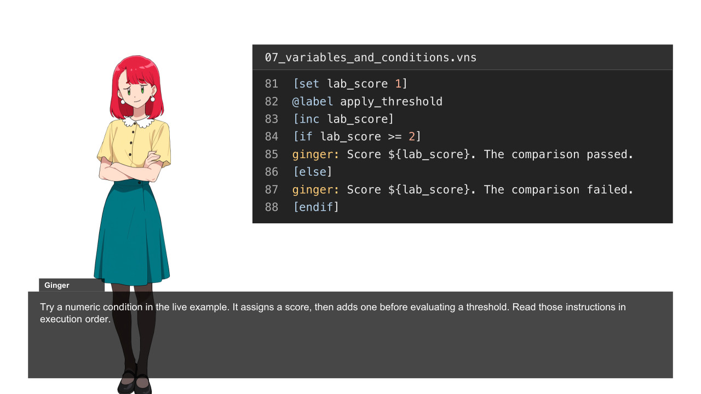

# Tutorial

Choose **New Project → Tutorial**, create the project, and press **Run**. Choose **Start tutorial** to meet Ginger. After her introduction, the pannable topic tree opens in the game window. Select a lesson to play. The 52 lessons can be taken in any order. **Back to topics** returns to the category and records completion once. **Progress and motion** shows your total and the motion controls.

Drag on empty space to pan, scroll or pinch to zoom, and select a category heading to focus on its lessons. Use **Find a lesson** (Ctrl+F or Command+F) to search titles and categories. Select a result to bring its card into view. Use **Fit map** or Home to see the whole course, **+** and **−** to zoom from the keyboard, and **Full screen** or F11 to toggle the game window between full screen and its previous size. Edit the map titles, icons and routes in `config/ui/tutorial-topics.properties`.

## Try a lesson with the source open

1. Open **Writing and branching → Dialogue**. Compare Ginger’s rendered line with the speaker ID and formatting tags shown in the numbered code panel.
2. In the editor, open `scripts/tutorial/01_dialogue_basics.vns`. Move the emphasis tags to another word inside the example’s marked region and save.
3. Reopen the lesson. The excerpt shows the edited file with its original line numbers. Check that the emphasis in the dialogue moved to the same word.
4. Try the practice exercise. An incorrect answer gives you a hint and lets you try again. To work on something else, return to topics.

The hub lives in `scripts/story/tutorial_hub.vns`. Each numbered lesson lives under `scripts/tutorial/`. Character and background declarations are in `scripts/definitions/characters.vns`. For your own teaching panel, follow [Show a source excerpt in dialogue](show-source-in-dialogue.md).

The [0.9.6 release](../project-setup/release/whats-new-0.9.6.md) includes an earlier playable tutorial download. Generate the expanded course in **New Project → Tutorial** from an editor build that includes the topic map.

## Lesson references

| Lesson | Source | Reference |
|---|---|---|
| 01. Dialogue Basics | `01_dialogue_basics.vns` | [VNS Dialogue & Text](../scripting/vns/language/vns-dialogue.md) |
| 02. Narration And Pacing | `02_narration_and_pacing.vns` | [VNS Settings & Playback Modes](../scripting/vns/runtime/vns-settings-modes.md) |
| 03. Expressions And Characters | `03_expressions_and_characters.vns` | [Layered Character Presets Guide](../scripting/vns/presentation/vns-layered-charpresets.md) |
| 04. Images And Backgrounds | `04_images_and_backgrounds.vns` | [VNS Directives & Declarations](../scripting/vns/language/vns-directives.md) |
| 05. Transitions And Effects | `05_transitions_and_effects.vns` | [VNS Transitions & Screen Effects](../scripting/vns/presentation/vns-transitions.md) |
| 06. Audio And Music | `06_audio_and_music.vns` | [VNS Audio Commands](../scripting/vns/presentation/vns-audio.md) |
| 07. Variables And Conditions | `07_variables_and_conditions.vns` | [VNS Variables & Conditions](../scripting/vns/language/vns-variables.md) |
| 08. Character Movement | `08_character_movement.vns` | [VNS Characters & Sprites](../scripting/vns/presentation/vns-characters.md) |
| 09. Puppeteer Timeline | `09_puppeteer_timeline.vns` | [Puppeteer — Animation Timeline Editor](../editor/puppeteer/puppeteer.md) |
| 10. Choices And Menus | `10_choices_and_menus.vns` | [VNS Choices & Branching](../scripting/vns/language/vns-choices.md) |
| 11. Subroutines And Flow | `11_subroutines_and_flow.vns` | [VNS Subroutines & Flow Control](../scripting/vns/flow/vns-flow-control.md) |
| 12. Best Practices | `12_best_practices.vns` | [VNS Best Practices & Common Pitfalls](../scripting/vns/guides/vns-best-practices.md) |
| 13. Camera And Staging | `13_camera_and_staging.vns` | [JES Camera System](../scripting/jes/systems/jes-camera.md) |
| 14. Localization And Textkeys | `14_localization_and_textkeys.vns` | [Localization Workflow](../project-setup/content/localization.md) |
| 15. UI Layout And Theme | `15_ui_layout_and_theme.vns` | [UI By Example](../guides/ui-by-example.md) |
| 16. Testing And Release | `16_testing_and_release.vns` | [Deployment & Packaging](../project-setup/release/deployment.md) |
| 17. VNS / JES Integration | `17_vns_jes_integration.vns` | [VNS ↔ JES Architecture & Coordination](../scripting/vns/integration/vns-jes-architecture.md) |
| 18. Plugins and Pikupiku | `18_plugins_and_line_boil.vns` | [Image Effects and Pikupiku](../plugins/image-effects.md) |
| 19. Saves, Rollback and Persistence | `19_saves_rollback_persistence.vns` | [VNS Save System](../scripting/vns/runtime/vns-save-system.md) |
| 20. Dialogue Presentation | `20_dialogue_presentation.vns` | [VNS Interop & Integration](../scripting/vns/integration/vns-interop.md) |
| 21. Reactive UI and Facets | `21_reactive_ui_and_facets.vns` | [VNS By Example — Reactive UI with Facets](../guides/vns-by-example/11-reactive-ui-and-facets.md) |
| 22. Phone Storytelling | `22_phone_storytelling.vns` | [VNS By Example — Phone Storytelling](../guides/vns-by-example/12-phone-storytelling.md) |
| 23. Particles and Audio Visualizers | `23_particles_and_visualizers.vns` | [VNS Commands Reference](../scripting/vns/language/vns-commands.md) |
| 24. Layers, Display Slots and Lighting | `24_layer_groups_and_lighting.vns` | [Movable Character Layer Groups](../scripting/vns/presentation/vns-movable-layer-groups.md) |
| 25. JES Entities, Input and Widgets | `25_jes_entities_input_widgets.vns` | [JES By Example](../guides/jes-by-example.md) |
| 26. JES Worlds, Physics, RPG and AI | `26_jes_worlds_physics_rpg.vns` | [JES By Example — Tilemap World](../guides/jes-by-example/07-tilemap-world.md) |
| 27. Editor Workflows | `27_editor_workflows.vns` | [Editor](../editor/core/editor.md) |
| 28. Assets and Performance | `28_assets_and_performance.vns` | [Asset Management & Path Resolution](../runtime/systems/asset-management.md) |
| 29. Accessibility, Settings and Controls | `29_accessibility_and_controls.vns` | [VNS Settings & Playback Modes](../scripting/vns/runtime/vns-settings-modes.md) |
| 30. Extensions and Capstone | `30_java_extensions_and_capstone.vns` | [Java + JES + VNS Cross Development](../scripting/vns/integration/java-jes-cross-development.md) |
| 31. Gated choices | `31_gated_choices.vns` | [Reference](../scripting/vns/language/vns-choices.md) |
| 32. Display slots | `32_display_slots.vns` | [Reference](../scripting/vns/presentation/vns-display-slots.md) |
| 33. Text styles | `33_text_styles.vns` | [Reference](../scripting/vns/language/vns-text-formatting.md) |
| 34. Persistent profiles | `34_profile_state.vns` | [Reference](../scripting/vns/language/vns-variables.md) |
| 35. Shared declarations | `35_shared_declarations.vns` | [Reference](../scripting/vns/language/vns-directives.md) |
| 36. Audio channels | `36_audio_channels.vns` | [Reference](../scripting/vns/presentation/vns-audio.md) |
| 37. Modal results | `37_facet_return_values.vns` | [Reference](../scripting/ui/facets.md) |
| 38. Topic map | `38_topic_map.vns` | [Reference](../scripting/vns/language/vns-choices.md) |
| 39. JES widgets | `39_jes_widgets.vns` | [Reference](../scripting/jes/gameplay/jes-ui-widgets.md) |
| 40. JES cameras | `40_jes_camera.vns` | [Reference](../scripting/jes/systems/jes-camera.md) |
| 41. History contrast | `41_history_contrast.vns` | [Reference](../scripting/vns/runtime/vns-rollback-history.md) |
| 42. Release smoke tests | `42_release_smoke_check.vns` | [Reference](../project-setup/release/deployment.md) |
| 43. Tilemaps and collision | `43_tilemap_world.vns` | [Reference](../guides/jes-by-example/07-tilemap-world.md) |
| 44. Physics and restitution | `44_physics_lab.vns` | [Reference](../guides/jes-by-example/09-physics-bodies.md) |
| 45. AI steering and pathfinding | `45_ai_lab.vns` | [Reference](../scripting/jes/gameplay/jes-ai.md) |
| 46. RPG items and stats | `46_inventory_lab.vns` | [Reference](../scripting/jes/gameplay/jes-rpg.md) |
| 47. Plural and number formatting | `47_plural_format.vns` | [Reference](../scripting/vns/language/vns-text-formatting.md) |
| 48. Layer groups and pivot points | `48_group_pivots.vns` | [Reference](../scripting/vns/presentation/vns-movable-layer-groups.md) |
| 49. JES keyboard actions | `49_jes_input.vns` | [JES Input Bindings](../scripting/jes/systems/jes-input.md) |
| 50. JES results in VNS | `50_jes_return.vns` | [JES VN Bridge & Java Hooks](../scripting/jes/integration/jes-bridge.md) |
| 51. Tile triggers | `51_tile_triggers.vns` | [JES Tilemaps](../scripting/jes/systems/jes-tilemaps.md) |
| 52. Parallel JES timelines | `52_parallel_timeline.vns` | [JES Timeline](../scripting/jes/timeline/jes-timeline.md#parallel) |
