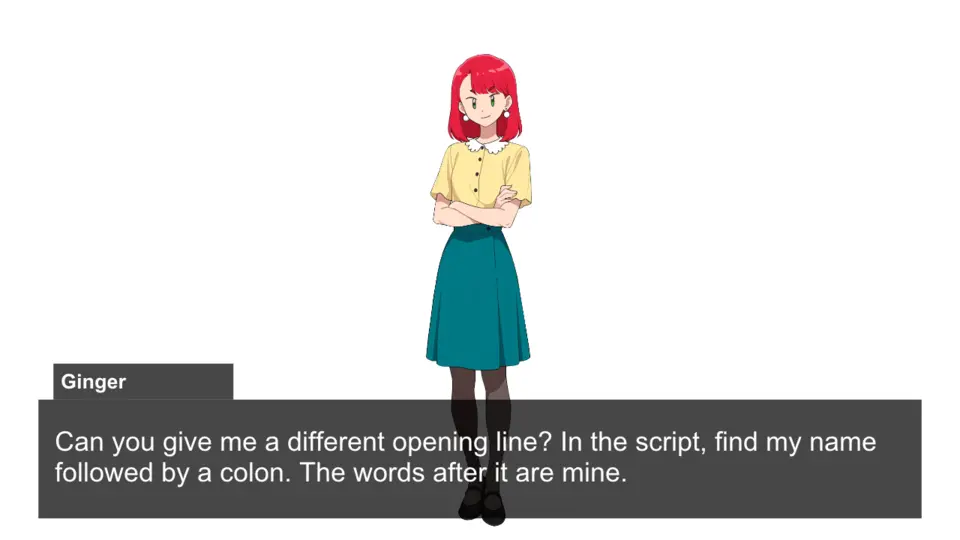

# JVN Tutorial

Choose **Start tutorial** and select a topic. Each example explains one feature, shows the relevant commands, and suggests an edit to try. Choose **Back to topics** to finish, or take the optional review question. Replaying a topic counts once.

Use **Progress and motion** to check completion or toggle movement. Try **Character movement** to see Pip walk, **Puppeteer timelines** to edit Pip’s movement, or **Stage lighting** to compare the stage before and after applying a preset.

The topic menu is in `scripts/story/tutorial_hub.vns`. The examples are in `scripts/tutorial/` and the background and character poses are in `assets/tutorial/`.

[Watch the character movement example.](../assets/images/tutorial/pip-walk.mp4)

## Lesson references

| Lesson | Source | Reference |
|---|---|---|
| 01. Dialogue Basics | `01_dialogue_basics.vns` | [Guide](https://javavectornexus.com/doc.html?page=docs/scripting/vns/language/vns-dialogue.md) |
| 02. Narration And Pacing | `02_narration_and_pacing.vns` | [Guide](https://javavectornexus.com/doc.html?page=docs/scripting/vns/runtime/vns-settings-modes.md) |
| 03. Expressions And Characters | `03_expressions_and_characters.vns` | [Guide](https://javavectornexus.com/doc.html?page=docs/scripting/vns/presentation/vns-layered-charpresets.md) |
| 04. Images And Backgrounds | `04_images_and_backgrounds.vns` | [Guide](https://javavectornexus.com/doc.html?page=docs/scripting/vns/language/vns-directives.md) |
| 05. Transitions And Effects | `05_transitions_and_effects.vns` | [Guide](https://javavectornexus.com/doc.html?page=docs/scripting/vns/presentation/vns-transitions.md) |
| 06. Audio And Music | `06_audio_and_music.vns` | [Guide](https://javavectornexus.com/doc.html?page=docs/scripting/vns/presentation/vns-audio.md) |
| 07. Variables And Conditions | `07_variables_and_conditions.vns` | [Guide](https://javavectornexus.com/doc.html?page=docs/scripting/vns/language/vns-variables.md) |
| 08. Character Movement | `08_character_movement.vns` | [Guide](https://javavectornexus.com/doc.html?page=docs/scripting/vns/presentation/vns-characters.md) |
| 09. Puppeteer Timeline | `09_puppeteer_timeline.vns` | [Guide](https://javavectornexus.com/doc.html?page=docs/editor/puppeteer/puppeteer.md) |
| 10. Choices And Menus | `10_choices_and_menus.vns` | [Guide](https://javavectornexus.com/doc.html?page=docs/scripting/vns/language/vns-choices.md) |
| 11. Subroutines And Flow | `11_subroutines_and_flow.vns` | [Guide](https://javavectornexus.com/doc.html?page=docs/scripting/vns/flow/vns-flow-control.md) |
| 12. Best Practices | `12_best_practices.vns` | [Guide](https://javavectornexus.com/doc.html?page=docs/scripting/vns/guides/vns-best-practices.md) |
| 13. Camera And Staging | `13_camera_and_staging.vns` | [Guide](https://javavectornexus.com/doc.html?page=docs/scripting/jes/systems/jes-camera.md) |
| 14. Localization And Textkeys | `14_localization_and_textkeys.vns` | [Guide](https://javavectornexus.com/doc.html?page=docs/project-setup/content/localization.md) |
| 15. Ui Layout And Theme | `15_ui_layout_and_theme.vns` | [Guide](https://javavectornexus.com/doc.html?page=docs/guides/ui-by-example.md) |
| 16. Testing And Release | `16_testing_and_release.vns` | [Guide](https://javavectornexus.com/doc.html?page=docs/project-setup/release/deployment.md) |
| 17. Vns Jes Integration | `17_vns_jes_integration.vns` | [Guide](https://javavectornexus.com/doc.html?page=docs/scripting/vns/integration/vns-jes-architecture.md) |
| 18. Plugins and Pikupiku | `18_plugins_and_line_boil.vns` | [Guide](https://javavectornexus.com/doc.html?page=docs/plugins/image-effects.md) |
| 19. Saves, Rollback and Persistence | `19_saves_rollback_persistence.vns` | [Guide](https://javavectornexus.com/doc.html?page=docs/scripting/vns/runtime/vns-save-system.md) |
| 20. Dialogue Presentation | `20_dialogue_presentation.vns` | [Guide](https://javavectornexus.com/doc.html?page=docs/scripting/vns/integration/vns-interop.md) |
| 21. Reactive UI and Facets | `21_reactive_ui_and_facets.vns` | [Guide](https://javavectornexus.com/doc.html?page=docs/guides/vns-by-example/11-reactive-ui-and-facets.md) |
| 22. Phone Storytelling | `22_phone_storytelling.vns` | [Guide](https://javavectornexus.com/doc.html?page=docs/guides/vns-by-example/12-phone-storytelling.md) |
| 23. Particles and Audio Visualizers | `23_particles_and_visualizers.vns` | [Guide](https://javavectornexus.com/doc.html?page=docs/scripting/vns/language/vns-commands.md) |
| 24. Layers, Display Slots and Lighting | `24_layer_groups_and_lighting.vns` | [Guide](https://javavectornexus.com/doc.html?page=docs/scripting/vns/presentation/vns-movable-layer-groups.md) |
| 25. JES Entities, Input and Widgets | `25_jes_entities_input_widgets.vns` | [Guide](https://javavectornexus.com/doc.html?page=docs/guides/jes-by-example.md) |
| 26. JES Worlds, Physics, RPG and AI | `26_jes_worlds_physics_rpg.vns` | [Guide](https://javavectornexus.com/doc.html?page=docs/guides/jes-by-example/07-tilemap-world.md) |
| 27. Editor Workflows | `27_editor_workflows.vns` | [Guide](https://javavectornexus.com/doc.html?page=docs/editor/core/editor.md) |
| 28. Assets and Performance | `28_assets_and_performance.vns` | [Guide](https://javavectornexus.com/doc.html?page=docs/runtime/systems/asset-management.md) |
| 29. Accessibility, Settings and Controls | `29_accessibility_and_controls.vns` | [Guide](https://javavectornexus.com/doc.html?page=docs/scripting/vns/runtime/vns-settings-modes.md) |
| 30. Extensions and Capstone | `30_java_extensions_and_capstone.vns` | [Guide](https://javavectornexus.com/doc.html?page=docs/scripting/vns/integration/java-jes-cross-development.md) |
