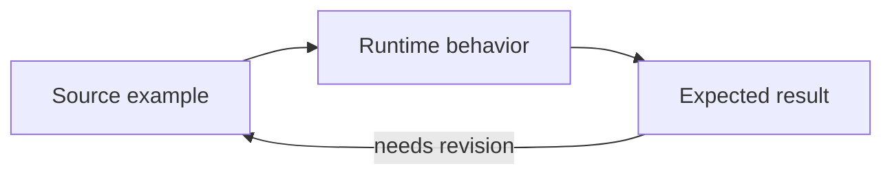

# Reading the JVN Docs

Use a tutorial when you want a working result, a how-to when you have one concrete task, a reference when you need exact syntax, and an architecture page when you need to understand the boundaries between systems.

## Read an annotated example

This example requires a project with a declared Lavender character and the bundled Pikupiku plugin:

```vns
# (1) Select the image effect for this character.
[set character.lavender.imageEffect pikupiku.lineboil]
# (2) Choose the held-drawing rate, independently of the game frame rate.
[set character.lavender.imageEffect.fps 6]
# (3) Draw the character with an existing expression.
[show lavender center happy]
Lavender: The scene is ready.
```

| Annotation | Meaning | What to check |
|---|---|---|
| (1) Effect ID | Registered plugin extension, not an asset path | Plugin loaded; character ID matches your declaration |
| (2) Typed setting | Drawings per second, integer 1–60 | The line boil changes while dialogue remains responsive |
| (3) Existing content | Uses your character’s expression and source layers | Art loads and stays aligned |

Comments are part of the copyable example. Placeholder paths in other examples must be replaced with real project assets before running them.

> [!NOTE]
> Notes explain context, assumptions, or a platform limitation.

> [!TIP]
> Tips offer a useful workflow or a practical check.

> [!IMPORTANT]
> Important annotations identify a contract that changes behavior, such as whether a screen blocks story progression.

> [!WARNING]
> Warnings belong beside a concrete destructive or irreversible operation, not beside ordinary editing steps.

## Read a diagram



The website renders Mermaid fences as diagrams. Each diagram has a title, an accessible description where authored, an expandable view, a downloadable SVG, and its original source. If rendering fails, the source stays available. GitHub also renders Mermaid fences in source Markdown.

Arrows represent the relationship described by the caption; they do not automatically imply a Java dependency or a required execution order. Sequence diagrams show messages over time, state diagrams show lifecycle transitions, and flowcharts show routes or data flow. The surrounding explanation remains useful without the image.

## Navigate and verify

Use **On this page** for long references, the heading’s `#` link for a precise citation, **View source** for the canonical Markdown, and **Improve this page** for the engine repository. Code blocks have a language label and a Copy button. Search works across the synchronized documentation tree.

Every tutorial should tell you its prerequisites, what to edit, what you should observe, and how to recover if it does not work. Compare examples with the current engine version and your chosen runtime backend. The generated Lavender workshop README links its 30 lessons to the reference pages that explain them in depth.

## Continue by task

| Goal | Next page |
|---|---|
| Learn by playing and editing | [Lavender workshop](lavender-workshop.md) |
| Create a first project | [Getting started](getting-started.md) |
| Pick VNS, JES, UI, or plugins | [Choose your path](choose-your-path.md) |
| Find an exact subsystem | [Documentation index](../INDEX.md) |
| Improve an explanation or diagram | [Maintenance guide](../MAINTENANCE.md) |
