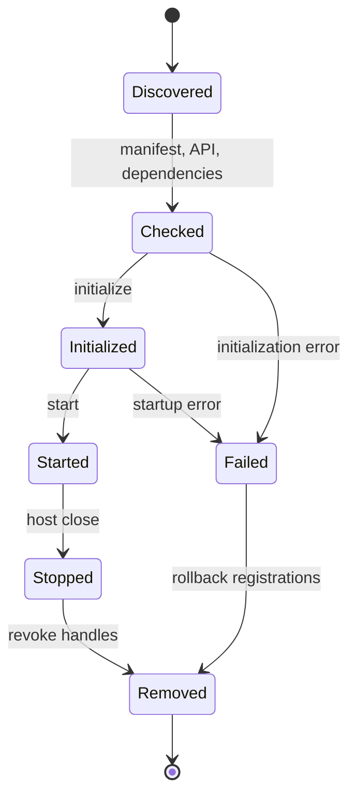

# Plugin host and lifecycle



> [!IMPORTANT]
> The lifecycle belongs to one host instance. Reload constructs a new host. A closed host cannot be restarted, and retained registry handles cannot add contributions after cleanup.

The diagram summarizes successful and failed activation. A missing or incompatible dependency can leave a discovered candidate inactive without ever invoking its entrypoint.

## Discovery

The shared host checks user plugins, project plugins, explicitly configured directories, and bundled `ServiceLoader` providers. External JARs are preflighted before construction: their manifest, Plugin API range, entrypoint type, and public no-argument constructor must all be valid. JARs are processed in filename order; identity and dependencies determine activation order.

Use **Engine Hub → Engine → Plugins → Manage Plugins** to search and filter installed bundles,
inspect manifests and checksums, see duplicate-ID or dependency diagnostics, install a verified JAR
into either scope, disable a bundle, or move it to the trash. Disabled bundles use the
`.jar.disabled` suffix and remain visible in the manager while the runtime ignores them. Hub
verification does not load, construct, or start plugin code; the editor performs the complete
entrypoint preflight when it reloads the project.

Set `-Djvn.plugins.disabled=true` to start JVN without loading plugins during recovery or diagnosis.

Bundled applications implement `BundledPluginProvider` and register its class in:

```text
META-INF/services/com.jvn.plugin.api.BundledPluginProvider
```

## Lifecycle

```text
discover → preflight → validate → dependency order → initialize → start
                                                   ↓
                                      listeners and extensions
                                                   ↓
                          stop in reverse dependency order
```

`initialize(context)` registers extensions and reads configuration. `start()` begins work after valid plugins initialize. `stop()` releases resources; the host then removes registrations and closes external JAR classloaders.

Initialization or startup failure marks only that plugin failed. Other independent plugins continue. Missing, cyclic, and incompatible dependencies prevent affected plugins from initializing.

`close()` is idempotent and terminal, even before `start()`. It closes discovered external classloaders as well as active plugins. A new host is required for reload. Registrations are removed on failure or shutdown and retained registration factories are revoked. Host-level registry views are read-only.

## Data and configuration

Each plugin receives `~/.jvn/plugin-data/<plugin-id>/`. If `config.properties` exists there, the host exposes an immutable key/value map through `PluginContext.configuration()`.

## Diagnostics

`PluginHost.diagnostics()` reports severity, plugin ID, stable code, message, and cause. Important codes include `jar-verify`, `jar-load`, `duplicate-id`, `api-incompatible`, dependency errors, lifecycle failures, and listener failures.

`PluginHost.plugins()` exposes descriptor, state, source JAR, and failure text for management UI.
