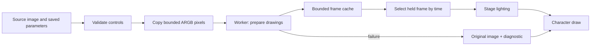

# Image Effects and Pikupiku



> [!NOTE]
> The image-effect API is independent of JavaFX. The current character-rendering integration is JavaFX-specific. Existing project files and source images are unchanged.

## Annotated script

```vns
# (1) Select the registered effect for one character.
[set character.lavender.imageEffect pikupiku.lineboil]
# (2) Override one typed numeric control.
[set character.lavender.imageEffect.strength 0.6]
# (3) Restore that control without deleting the whole effect selection.
[set character.lavender.imageEffect.strength default]
```

| Annotation | Why it matters |
|---|---|
| (1) Character scope | Other characters retain their own effect settings. |
| (2) Validated value | Unknown controls, non-finite values, and values outside the schema fall back safely in the renderer. |
| (3) Default override | Save/rollback state remains ordinary VNS data; the effect resolves its own default. |

Plugin API 1.2 adds prepared image effects. The bundled **Pikupiku Line Wiggler** is a native Java port of the MIT-licensed Pikupiku line-boil renderer: contour noise changes between held drawings while source colors and alpha stay anchored. It requires no FFmpeg subprocess.

## Use it in a scene

```vns
[set character.lavender.imageEffect pikupiku.lineboil]
[set character.lavender.imageEffect.strength 1.4]
[set character.lavender.imageEffect.fps 6]
[show lavender center happy]
Lavender: A drawing with a little life in its lines.

[set character.lavender.imageEffect none]
Lavender: The original image again.
```

Replace `lavender` with your character ID. Overrides use `character.<id>.imageEffect.<parameter>`. Set an override to `default` to use the effect's default again. Changing the effect ID does not delete old parameter variables; clear or reset overrides that do not belong to the new effect. Settings are ordinary VN state and follow save/load and rollback. `none` and `off` disable the effect.

The JavaFX VN renderer applies effects to the final character draw path, including layered expressions, transitions, and timeline-driven layer transforms. Stage lighting is applied after the selected drawing. Editor previews and the JavaFX runtime share the same integration. Other renderers do not yet consume image effects.

## Editor workflow

Open **Tools → Plugins → Pikupiku Line Wiggler**. The preview starts with layered Lavender on white. Open an image to use your own character. Select a preset, adjust controls, and use **Copy VNS settings** with the target character ID. **Animate** can freeze the preview.

**Export PNG drawings** creates a new subdirectory under your selected folder containing transparent numbered PNGs, `animation.properties` (frame count and FPS), and `effect.vns`. The preview and export use the same working image, limited to 1080 pixels on its longest edge. The source image remains unchanged. GIF-specific quantization and dithering are intentionally absent from the Java plugin; export is lossless PNG.

Presets: Lavender, Subtle, Strong, Graphite, Omori, Omori Color, and Off. Preset selection resets all controls to that preset's resolved values. The original tool's general-purpose contour, grading, texture, and loop controls are available as native parameters.

## Pikupiku parameters

| Parameter | Default | Range | Meaning |
|---|---:|---|---|
| `strength` | 1.4 | 0–4 | Overall contour and texture intensity |
| `amplitude` | 0.8 | 0–20 | Contour displacement in working-image pixels |
| `fps` | 6 | 1–60 integer | Held drawings per second |
| `frames` | 3 | 2–12 integer | Distinct prepared drawings |
| `ink` | 0.58 | 0–1 | Contour darkness |
| `threshold` | 32 | 1–255 | Edge detection threshold |
| `noiseScale` | 12 | 2–100 | Spatial noise spacing |
| `pressure` | 0.2 | 0–1 | Pencil pressure variation |
| `seed` | 0 | 0–99999 integer | Deterministic pattern seed |
| `lineWidth` | 1 | 1–5 integer | Contour dilation width |
| `grain` | 0 | 0–10 | Stationary paper grain |
| `simplify` | 0 | 0–1 | Quantized-color blending |
| `levels` | 5 | 2–16 integer | Color quantization levels |
| `smoothing` | 0 | 0–5 integer | Color-aware smoothing radius |
| `saturation` | 1 | 0–2 | Color saturation |
| `contrast` | 1 | 0.1–3 | Color contrast |
| `brightness` | 0 | −100–100 | Brightness adjustment |
| `paper` | 0 | 0–1 | White-paper blend |
| `hatch` | 0 | 0–1 | Shadow hatching |
| `inkTone` | 28 | 0–255 integer | Grayscale ink value |
| `pingpong` | 0 | 0 or 1 | Reverse through interior drawings |

The Off preset restores default grading with zero strength. Setting only strength to zero does not reset explicitly changed saturation, contrast, or brightness controls. All alpha values are preserved; fully transparent pixels are normalized to transparent black.

## Implement an effect

Declare `image.effect` and require `jvnApi: ">=1.2.0 <2.0.0"`. Use a qualified lowercase effect ID:

```java
@Override
public void initialize(PluginContext context) {
    context.contribute().images().effect("studio.outline", new OutlineEffect());
}
```

Implement `com.jvn.plugin.api.image.ImageEffect`:

- `label()` and optional `description()` explain the effect.
- `parameters()` describes numeric controls with defaults, finite ranges, and integer constraints.
- `presets()` returns named partial parameter maps. `resolve()` validates supplied values, fills defaults, and rejects unknown names.
- `prepare(ImagePixels, Map<String, Double>)` returns an `ImageAnimation`. It may throw a useful exception if preparation cannot complete.

`ImagePixels` contains immutable straight-alpha ARGB pixels. Constructor and accessor copy the array. Dimensions must be positive and at most 4,194,304 pixels. `ImageAnimation` snapshots its frame list, requires equal dimensions, supports 1–120 frames at 1–60 FPS, and caps declared frame storage at 64 MiB. Preserve the supplied dimensions; handle alpha deliberately. Use deterministic seeds for reproducible results.

Effects must be thread-safe: the preview, renderer, and export worker may prepare concurrently. Check interruption during expensive work. Avoid mutable global state, external side effects, and UI toolkit calls in `prepare`.

To expose the standard studio as a plugin tool, request `editor.tool` as well and use the typed optional service:

```java
context.service(ImageEffectEditor.class).orElseThrow().open("studio.outline");
```

Here `context` is the `EditorToolContext` passed to `EditorTool.open`, not the lifecycle `PluginContext`. Hosts without this service may provide a different editor UI.

## Host behavior and lifecycle

The JavaFX host copies a bounded working image, prepares effects on a daemon worker, and reuses held frames. At most four preparations are pending per cache; completed frames use an LRU cache bounded by 24 entries and 96 MiB. The 64 MiB per-animation limit also bounds each pending result. Preparation errors leave the original image visible and are logged once per cached request. Invalid parameters or unavailable effects also fall back to the original.

Clearing a renderer cancels pending work. Disposing it closes its executor. Source identity, effect instance identity, and resolved parameters determine cache entries, so reloaded plugins cannot reuse an older implementation's drawings. Stopped plugins lose all registrations, and retained registry handles cannot register new contributions afterward. Host registry views are read-only. Create a new `PluginHost` to reload a closed host.

The complete implementation and original MIT notice are in [the bundled plugin module](../../modules/plugin-pikupiku/README.md). See [API reference](api-reference.md), [lifecycle](host-reference.md), and [compatibility](compatibility-security.md).
