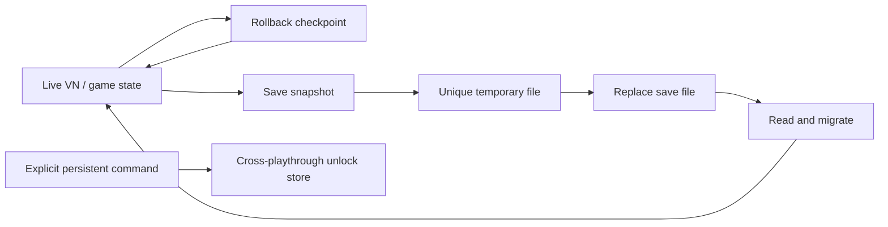

# Save System



> [!IMPORTANT]
> Save/load, rollback, and persistent unlocks are separate contracts. External side effects are not automatically reversed when story state rewinds.

**Verification:** save before and after a choice, change character presentation, then load both snapshots. Check variables, visible characters, settings, phone data, and any game-specific state you registered.

JVN save/load is schema-versioned, migration-aware, and write-failure-safe.

Primary classes:
- `modules/core/src/main/java/com/jvn/core/vn/save/VnSaveData.java`
- `modules/core/src/main/java/com/jvn/core/vn/save/VnSaveMigration.java`
- `modules/core/src/main/java/com/jvn/core/vn/save/VnSaveManager.java`
- `modules/core/src/main/java/com/jvn/core/vn/save/VnSaveSerializer.java`

## Storage Format

Save slots are stored as JSON files:

- `<slot>.json`
- temp write path: `<slot>.json.tmp`

Legacy `.sav` files are still readable and are migrated forward to JSON on load.

Default save directory:

```text
~/.jvn/games/<game-id>/saves
```

The runtime reads `id` from `jvn.project`. For older manifests without `id`,
it derives a stable ID from `author` and `name`. This keeps slots, quick saves,
and autosaves isolated between installed games. A process with no active game
retains the legacy `~/.jvn/saves` location.

You can override it with `new VnSaveManager("/custom/path")`.

## Current Schema

Current schema version:
- `CURRENT_SCHEMA_VERSION = 6`

`VnSaveData` persists:
- identity: `schemaVersion`, `scenarioId`, `saveName`, `saveTimestamp`
- progression: `currentNodeIndex`, `readNodes`
- scene state: `currentBackgroundId`, `visibleCharacters`
- state variables: `variables`
- call/return flow: `callStack`
- character-global-position metadata:
  - `globalPositionCharacters`
  - `characterDefinedPositions`
- UX modes:
  - `skipMode`
  - `autoPlayMode`
  - `autoPlayTimer`
  - `uiHidden`
- settings snapshot:
  - text/audio/autoplay flags
  - physics defaults (`physicsFixedStepMs`, `physicsMaxSubSteps`, `physicsDefaultFriction`)
  - input profile fields (`inputProfilePath`, `inputProfileSerialized`)
  - display fields (`displayWidth`, `displayHeight`, `autoFitResolution`)
  - accessibility fields (`accessibilityTheme`, `textToSpeechEnabled`, `uiFontScale`)
- optional RPG payload: `rpgState` (serialized to base64 when serializable)

## Example Save Payload (Abbreviated)

```json
{
  "schemaVersion": 4,
  "scenarioId": "prologue",
  "nodeIndex": 42,
  "backgroundId": "field_day",
  "callStack": [13, 27],
  "globalPositionCharacters": ["codel"],
  "characterDefinedPositions": {
    "codel": "RIGHT"
  },
  "skipMode": false,
  "autoPlayMode": true,
  "autoPlayTimer": 834,
  "uiHidden": false,
  "settings": {
    "textSpeed": 28,
    "bgmVolume": 0.7,
    "clickRevealBeforeAdvance": true
  },
  "rpgStateSerialized": "..."
}
```

## Migration Behavior

`VnSaveMigration.migrateInPlace(...)` handles:
- legacy/null schema normalization
- `v1 -> v2`
- `v2 -> v3`
- `v3 -> v4`
- null collection/object normalization
- save-name and timestamp recovery
- schema bump to current

Migration is run on:
- save write path (normalization before writing)
- load path (normalization after reading)

If load-time migration changes the payload, manager writes migrated JSON back to disk.

## Write Reliability

`VnSaveManager` uses failure-safe writes:

1. write JSON to `<slot>.json.tmp`
2. move temp -> final with `ATOMIC_MOVE` when available
3. fallback to replace move when atomic move is unsupported
4. cleanup temp residue

This avoids partially-written save files on interruptions/crashes.

## Autosave

Autosave defaults:
- prefix: `_autosave_`
- slots: `3`
- policy: overwrite oldest slot (or unreadable slot first)

Main APIs:
- `autosave(state)`
- `autosave(state, slotIndex)`
- `listAutoSaves()`
- `loadLatestAutoSave()`

## Applying Save Data Back to Runtime

`VnSaveManager.applyToState(...)` restores:
- node index/background/variables/read nodes
- call stack
- visible characters (+ their layer orders)
- global character position model
- skip/auto/ui mode values (including autoplay timer)
- full settings snapshot
- optional RPG state

Important detail:
- global character position metadata is applied after visible characters are restored, so authored character anchors are retained.

## Rollback vs Save/Load

Rollback (`VnRollbackEntry`) and save/load both restore state, but they are for different scopes:

- rollback: short-lived in-session history stack (undo/redo style)
- save/load: persistent disk snapshots across sessions

Both now preserve key continuity fields like call stack and character-global-position metadata.

## Operational Best Practices

- Keep custom `rpgState` compact and serializable.
- Use autosave at chapter/label checkpoints instead of every line.
- Keep save slot naming stable and machine-safe (manager sanitizes names).
- Add migration tests whenever schema is bumped.

## Schema Evolution Checklist

When adding save fields:

1. Update `VnSaveData`.
2. Bump `CURRENT_SCHEMA_VERSION`.
3. Add migration step in `VnSaveMigration`.
4. Update serializer read/write in `VnSaveSerializer`.
5. Update manager apply/save paths if needed.
6. Add/extend tests (`VnSavePersistenceTest`, robustness tests).
