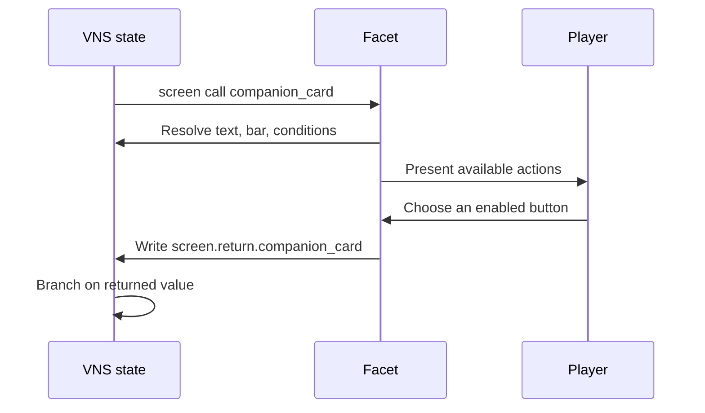

# JVN Facets



> [!TIP]
> A modal facet needs a reachable return action in every state. Keep a Close button available while experimenting with visibility and enabled conditions.

JVN Facets are composable, reactive user interfaces stored in `.facet` properties files. A Facet defines a tree of visual nodes whose content and visibility are resolved from the live visual-novel state every time the overlay is rendered.

Use a Facet when a normal menu row list or a single-title/single-body reactive screen is not enough—for example:

- a character status card with portrait, name, statistics, and meters;
- an inventory or quest summary assembled from several visual regions;
- a chapter card with conditional artwork;
- a heads-up display panel driven by story variables;
- a shop, confirmation, or information overlay with custom presentation;
- a reusable game-specific interface that still uses standard JVN screen actions.

Facets extend JVN's existing overlay-screen lifecycle. They do not introduce another screen stack, input router, or action language. The established `[screen show]` and `[screen call]` commands, modal behavior, timers, buttons, localization, conditions, and return values all continue to apply.

For a workflow that combines reactive UI with reusable scene animation, see [Reusable Authoring With Facets And Motifs](../../guides/facets-and-motifs.md). Motifs can coordinate motion around a Facet, but the current Facet contract does not animate individual nodes.

Implementation:

- model: `modules/core/src/main/java/com/jvn/core/vn/ui/VnFacetSpec.java`
- loader: `modules/core/src/main/java/com/jvn/core/vn/ui/VnReactiveScreenLoader.java`
- live binding: `modules/core/src/main/java/com/jvn/core/vn/ui/VnReactiveOverlayScreenSpec.java`
- JavaFX rendering: `modules/fx/src/main/java/com/jvn/fx/vn/VnRenderer.java`

---

## Facets, Reactive Screens, And Menus

These systems share some capabilities but serve different shapes of UI.

| Need | Recommended system |
|---|---|
| Main menu, settings, save/load, or keyboard/controller-first row navigation | Menu profiles and `.menu` files |
| Small dialog with a title, body, and buttons | Reactive `.screen` file |
| Nested freeform presentation with several text/image/meter regions | `.facet` file |
| Story dialogue box, choices, NVL, or bubble presentation | Dialogue layout/style system |

A Facet is still an overlay screen. It can contain standard overlay buttons, but its visual nodes are not menu rows and do not inherit menu-profile layout behavior.

---

## Minimal Example

Create `config/facets/status.facet`:

```properties
title=Party Status
width=0.58
height=0.46

nodes=name,health_label,health

node.name.type=text
node.name.text=${player_name}
node.name.x=0.08
node.name.y=0.20
node.name.width=0.84
node.name.height=0.14

node.health_label.type=text
node.health_label.text=Health
node.health_label.x=0.08
node.health_label.y=0.42
node.health_label.width=0.84
node.health_label.height=0.10

node.health.type=bar
node.health.value=${health_ratio}
node.health.x=0.08
node.health.y=0.56
node.health.width=0.84
node.health.height=0.08

buttons=close
button.close.label=Close
button.close.action=hide
```

Set the variables and show it from VNS:

```vns
[set player_name "Lavender"]
[set health_ratio 0.75]
[screen show status]
```

The runtime discovers `status.facet`, creates the normal reactive overlay, and renders the three Facet nodes inside its panel.

---

## Full Example

This example demonstrates nested groups, a variable-backed image, localized text, conditional content, a bar, a modal call, and a returned button value.

```properties
# config/facets/companion_card.facet

id=companion_card
title=i18n:companion.card.title
x=0.18
y=0.14
width=0.64
height=0.58
modal=true
dim=true
dismiss=false
call=true
returnKey=screen.return.companion_card

nodes=content,portrait,name,relationship_label,relationship,warning

# A nested coordinate container. Declare it before its children.
node.content.type=group
node.content.x=0.06
node.content.y=0.17
node.content.width=0.88
node.content.height=0.60

node.portrait.type=image
node.portrait.parent=content
node.portrait.value=${companion_portrait}
node.portrait.x=0.00
node.portrait.y=0.00
node.portrait.width=0.27
node.portrait.height=0.88

node.name.type=text
node.name.parent=content
node.name.text=${companion_name}
node.name.x=0.33
node.name.y=0.00
node.name.width=0.67
node.name.height=0.20

node.relationship_label.type=text
node.relationship_label.parent=content
node.relationship_label.text=i18n:companion.relationship
node.relationship_label.x=0.33
node.relationship_label.y=0.28
node.relationship_label.width=0.67
node.relationship_label.height=0.14

node.relationship.type=bar
node.relationship.parent=content
node.relationship.value=${relationship_ratio}
node.relationship.x=0.33
node.relationship.y=0.48
node.relationship.width=0.67
node.relationship.height=0.10

node.warning.type=text
node.warning.parent=content
node.warning.text=i18n:companion.relationship.low
node.warning.visibleIf=relationship_ratio < 0.25
node.warning.x=0.33
node.warning.y=0.68
node.warning.width=0.67
node.warning.height=0.18

buttons=invite,leave

button.invite.label=i18n:companion.invite
button.invite.action=return
button.invite.target=invite
button.invite.enabledIf=relationship_ratio >= 0.50

button.leave.label=i18n:common.close
button.leave.action=return
button.leave.target=leave
```

```vns
[set companion_name "Lavender"]
[set companion_portrait "assets/characters/lavender/portrait.png"]
[set relationship_ratio 0.72]

[screen call companion_card]
[if screen.return.companion_card == "invite" goto invite_companion]
[goto continue_story]
```

---

## File Discovery And Precedence

`[screen show <id>]` and `[screen call <id>]` search in this order:

1. `config/facets/<id>.facet`
2. `config/screens/<id>.screen`
3. `config/screens/<id>.properties`
4. `screens/<id>.screen`
5. `screens/<id>.properties`
6. `<id>.screen`
7. `<id>.properties`
8. `<id>.facet`

The first existing file wins. Consequently, `config/facets/shop.facet` intentionally overrides `config/screens/shop.screen` when both exist.

If none of these files exists, JVN falls back to the inline `[screen show ...]` or `[screen call ...]` syntax.

Recommended convention:

```text
config/
├── facets/
│   ├── companion_card.facet
│   ├── quest_summary.facet
│   └── status.facet
└── screens/
    ├── confirm.screen
    └── chapter_popup.screen
```

---

## File Format

A `.facet` file uses UTF-8 Java properties syntax:

```properties
key=value
```

- Empty lines are allowed.
- Lines beginning with `#` are comments.
- Keys and values are trimmed by the loader.
- Node IDs and button IDs should use `snake_case`.
- Duplicate properties follow normal Java `Properties` behavior: the last value wins.

The file contains three layers:

1. overlay fields controlling the panel and lifecycle;
2. `node.<id>.*` fields defining the Facet tree;
3. optional `button.<id>.*` fields defining interaction.

---

## Overlay Fields

Facets accept the same top-level fields as reactive screens.

| Key | Default | Meaning |
|---|---:|---|
| `id` | requested screen ID | Runtime overlay ID |
| `title` | overlay ID | Panel title; localized and interpolated at render time |
| `text` / `body` | empty | Optional legacy body rendered before Facet nodes |
| `visibleIf` | empty | Condition controlling the entire overlay |
| `x` | `0.18` | Panel X as a viewport fraction |
| `y` | `0.18` | Panel Y as a viewport fraction |
| `width` / `w` | `0.64` | Panel width as a viewport fraction |
| `height` / `h` | `0.42` | Panel height as a viewport fraction |
| `modal` | value of `call` | Whether the overlay blocks interaction behind it |
| `dim` / `dimBackground` | `true` | Whether the first dimming overlay draws the dark backdrop |
| `dismiss` / `dismissOnAdvance` | opposite of `call` | Whether normal advance input dismisses it |
| `call` | `false` | Marks the file as a call-style overlay |
| `timer` | `0` | Lifetime in milliseconds; `0` disables the timer |
| `timerAction` | `return` for calls, otherwise `hide` | Action when the timer expires |
| `timerTarget` | empty | Timer return value or action target |
| `returnKey` | `screen.return.<id>` | VNS variable receiving a call return value |
| `root` | `root` | ID used for the implicit root coordinate box |

All panel dimensions are clamped by the reactive-screen model. Node dimensions are not clamped; see [Geometry Rules](#geometry-rules).

---

## Declaring Nodes

The recommended form explicitly lists nodes:

```properties
nodes=container,title,portrait,meter
```

The list determines rendering and parent-resolution order. Declare a parent before every child that refers to it.

If `nodes` is absent or empty, the loader discovers IDs by scanning keys beginning with `node.`. Explicit `nodes=` is preferable because `Properties` key iteration does not provide a useful author-controlled visual order.

Each node uses this prefix:

```properties
node.<id>.<field>=<value>
```

For example:

```properties
node.hero_name.type=text
node.hero_name.text=${player_name}
```

---

## Common Node Fields

| Field | Default | Meaning |
|---|---:|---|
| `type` | `text` | `group`, `text`, `image`, or `bar` |
| `parent` | `root` | Parent group ID |
| `text` | empty | Text-node content |
| `value` | empty | Image asset path or bar numeric value |
| `visibleIf` | empty | Live VNS condition; empty means visible |
| `x` | `0.0` | X offset as a fraction of the parent width |
| `y` | `0.0` | Y offset as a fraction of the parent height |
| `width` | `1.0` | Width as a fraction of the parent width |
| `height` | `0.1` | Height as a fraction of the parent height |

Unknown `type` values currently produce a loader diagnostic and fall back to `text`.

---

## Node Types

### `group`

A group is an invisible coordinate container. It does not draw a background or capture input. Its geometry becomes the coordinate space for later child nodes.

```properties
nodes=card,name,meter

node.card.type=group
node.card.x=0.08
node.card.y=0.20
node.card.width=0.84
node.card.height=0.60

node.name.type=text
node.name.parent=card
node.name.text=${player_name}

node.meter.type=bar
node.meter.parent=card
node.meter.y=0.40
node.meter.height=0.12
node.meter.value=${energy_ratio}
```

Important: `card` must occur before `name` and `meter` in `nodes=`. If a parent has not been resolved yet, the renderer uses the root panel as the fallback coordinate space for that child.

### `text`

A text node renders localized and interpolated text inside its geometry.

```properties
node.balance.type=text
node.balance.text=Coins: ${coins}
node.balance.x=0.10
node.balance.y=0.30
node.balance.width=0.80
node.balance.height=0.16
```

Behavior:

- `text` is passed through `Localization.translateText`.
- The translated result is interpolated from live `VnState` variables.
- Text wraps on whitespace to fit the node width.
- Lines beyond the node height are clipped by omission.
- The current renderer uses the active dialogue font and Facet-default color/weight.
- There are currently no per-node typography, alignment, or color fields.

Localization examples:

```properties
node.heading.text=i18n:status.heading
node.summary.text=${player_name}: ${quest_count} quests
```

### `image`

An image node resolves `value` as an asset path and draws it into the node rectangle.

```properties
node.portrait.type=image
node.portrait.value=${portrait_path}
node.portrait.x=0.06
node.portrait.y=0.20
node.portrait.width=0.26
node.portrait.height=0.56
```

Behavior:

- `value` is localized and interpolated before loading.
- A blank value draws nothing.
- Loading uses the normal VN image cache and asset resolution path.
- The image is scaled to the node rectangle.
- Aspect ratio is not preserved automatically; size the node accordingly.
- A failed or unresolved image draws nothing.

### `bar`

A bar renders a fixed background track and a filled cyan foreground.

```properties
node.health.type=bar
node.health.value=${health_ratio}
node.health.x=0.36
node.health.y=0.58
node.health.width=0.56
node.health.height=0.07
```

Behavior:

- `value` is interpolated and parsed as a decimal number.
- Values below `0.0` clamp to `0.0`.
- Values above `1.0` clamp to `1.0`.
- Blank or nonnumeric values use `0.0`.
- Use a ratio, not a percentage: `0.75`, not `75`.
- Bar colors are currently renderer defaults and are not configurable per node.

To convert game values, store the ratio in VNS or Java before showing the Facet:

```vns
[set health_ratio 0.75]
```

---

## Geometry Rules

Facet geometry is hierarchical and normalized.

For a node with parent rectangle `(parentX, parentY, parentWidth, parentHeight)`:

```text
pixelX      = parentX + parentWidth  * x
pixelY      = parentY + parentHeight * y
pixelWidth  = parentWidth  * width
pixelHeight = parentHeight * height
```

The renderer enforces a minimum rendered width and height of one pixel. It does not otherwise clamp nodes to the parent or viewport.

Consequences:

- `x=0`, `y=0`, `width=1`, `height=1` fills the parent.
- `x=0.25`, `width=0.5` occupies the centered half of the parent width.
- Values greater than `1` may extend outside the parent.
- Negative X/Y values may draw before the parent origin.
- Children are not automatically clipped to parent group bounds.
- Later nodes draw over earlier nodes.

Use explicit `nodes=` ordering to control both parent resolution and paint order.

---

## Reactive Evaluation

Facet data is evaluated against the current `VnState`, not frozen when the overlay opens.

### Text and value interpolation

```properties
node.coins.text=Coins: ${coins}
node.portrait.value=${active_portrait}
node.health.value=${health_ratio}
```

When one of these variables changes, the next render resolves the new value.

### Conditional visibility

```properties
node.warning.visibleIf=health_ratio < 0.20
node.secret.visibleIf=persistent.trueEnding == true
```

Conditions use `VnConditionEvaluator`, the same evaluator used for VNS choices and reactive-screen button conditions. If an expression is blank, the node is visible. If evaluation throws, the runtime uses the safe fallback of visible.

Persistent values can participate when mirrored into VNS variables with the `persistent.<key>` convention.

### Entire-overlay visibility

Top-level `visibleIf` controls the complete overlay:

```properties
visibleIf=ui.status_open == true
```

When this becomes false, the runtime treats the reactive overlay as not currently visible.

---

## Buttons And Interaction

Facet visual nodes are presentation-only in the current contract. Interaction uses the established overlay buttons.

```properties
buttons=accept,cancel

button.accept.label=Accept
button.accept.action=return
button.accept.target=accepted
button.accept.enabledIf=coins >= price

button.cancel.label=Cancel
button.cancel.action=return
button.cancel.target=cancelled
```

Button fields:

| Field | Default | Meaning |
|---|---:|---|
| `label` | button ID | Localized/interpolated label |
| `action` | `noop` | Overlay/VNS action |
| `target` | empty | Action target or returned value |
| `enabled` | `true` | Static enabled state |
| `enabledIf` | empty | Live enabled condition |
| `visibleIf` | empty | Live visibility condition |
| `x`, `y` | automatic row | Position |
| `width`, `height` | automatic | Size |
| `space` / `coordinateSpace` | `screen` | `screen` or `viewport` |

Common actions:

| Action | Result |
|---|---|
| `return` | Writes `target` to the return key and closes the called overlay |
| `hide`, `close`, `dismiss` | Closes an overlay |
| `goto` | Jumps to a VNS label |
| `advance` | Advances the VN scene |
| `screen` | Runs another screen command |
| `set`, `flag`, `unflag`, `clear`, `inc`, `dec` | Routes to variable interop |
| `persistent` | Routes to persistent interop |

See [Reactive Overlay Screens](menus/reactive-screens.md) and [Menu Actions And Navigation](layout/structure/menu-actions.md) for the shared action behavior.

Current interaction boundaries:

- Facet `text`, `image`, `bar`, and `group` nodes do not receive pointer events.
- Buttons are not children of groups; they use overlay screen or viewport coordinates.
- There is no Facet node focus tree, scrolling container, input field, slider, drag target, or node-level action yet.

---

## Show Versus Call

### Show without waiting

```vns
[screen show status]
```

Story execution continues. This is appropriate for informational or HUD-like overlays.

### Call and consume a result

```vns
[screen call companion_card]
[if screen.return.companion_card == "invite" goto invite_companion]
```

Use buttons with `action=return` and a `target` value. Called screens default to modal behavior and do not default to advance-to-dismiss.

### Hide explicitly

```vns
[screen hide status]
```

---

## Timers

Facets inherit reactive-screen timers:

```properties
timer=3000
timerAction=hide
```

For a timed call:

```properties
call=true
timer=5000
timerAction=return
timerTarget=timeout
```

```vns
[screen call timed_prompt]
[if screen.return.timed_prompt == "timeout" goto missed_prompt]
```

The current renderer displays the standard overlay timer indicator. The indicator's visual ratio uses the overlay renderer's existing timer presentation.

---

## Validation And Diagnostics

The loader records diagnostics for:

- a blank requested screen ID;
- asset-loading failures;
- invalid numeric properties;
- invalid timer integers;
- unknown Facet node types.

Safe fallbacks are used where possible:

| Problem | Fallback |
|---|---|
| Unknown node type | `text` |
| Invalid node number | Field default |
| Failed `visibleIf` evaluation | Visible |
| Nonnumeric bar value | `0.0` |
| Missing parent at render time | Root panel |
| Blank image path | Nothing drawn |

The loader does not currently reject duplicate node IDs, parent cycles, children declared before parents, off-panel geometry, or unresolved interpolation variables. Keep explicit node ordering and test the Facet in the runtime preview.

---

## Authoring Patterns

### Reusable content inset

```properties
nodes=content,...
node.content.type=group
node.content.x=0.06
node.content.y=0.18
node.content.width=0.88
node.content.height=0.64
```

Place all visual content inside `content` so the panel title and buttons have predictable space.

### Conditional warning

```properties
node.warning.type=text
node.warning.text=Low health
node.warning.visibleIf=health_ratio < 0.20
```

### Swappable portrait

```properties
node.portrait.type=image
node.portrait.value=${active_portrait}
```

Change `active_portrait` while the Facet is open to change the rendered asset.

### Layered artwork

```properties
nodes=frame,portrait,badge
```

Because later nodes paint later, `badge` appears over `portrait`, which appears over `frame`.

### Facet-backed choice prompt

Use Facet nodes for custom presentation and normal overlay buttons for decisions:

```properties
nodes=illustration,prompt
node.illustration.type=image
node.illustration.value=assets/ui/decision.png
node.prompt.type=text
node.prompt.text=Spend ${price} coins?

buttons=yes,no
button.yes.action=return
button.yes.target=yes
button.yes.enabledIf=coins >= price
button.no.action=return
button.no.target=no
```

---

## Migration From A Reactive `.screen`

Start with an existing screen:

```properties
# config/screens/status.screen
title=Status
text=Coins: ${coins}
buttons=close
button.close.action=hide
```

Create `config/facets/status.facet`, retain the panel and button fields, and replace the single body with nodes:

```properties
title=Status
nodes=coins,health

node.coins.type=text
node.coins.text=Coins: ${coins}

node.health.type=bar
node.health.value=${health_ratio}
node.health.y=0.30

buttons=close
button.close.action=hide
```

No VNS call-site change is necessary because both use `[screen show status]` or `[screen call status]`.

---

## Current Contract And Limitations

The first Facet contract deliberately establishes a small, stable foundation:

- property-backed `.facet` files;
- ordered nested geometry;
- `group`, `text`, `image`, and `bar` nodes;
- live interpolation and conditional visibility;
- integration with established overlay buttons and lifecycle.

Not currently implemented:

- automatic row, column, grid, or wrap layout;
- reusable Facet includes/components;
- loops over collections;
- node parameters or local scope;
- per-node typography, color, borders, backgrounds, or image fit modes;
- node-level actions, hover states, keyboard focus, or accessibility semantics;
- scroll/viewport nodes, inputs, sliders, or drag-and-drop;
- Puppeteer animation attached directly to Facet nodes;
- automatic clipping to parent geometry.

These are extension points for the Facet node model, not features silently implied by the current format.

---

## Troubleshooting

| Symptom | Likely cause | Fix |
|---|---|---|
| Legacy `.screen` appears instead | Facet is not at the higher-priority path | Put it at `config/facets/<id>.facet` |
| Child is positioned against the whole panel | Parent was missing or declared after the child | Put the parent earlier in `nodes=` |
| Nodes overlap unexpectedly | Paint order follows `nodes=` | Reorder the list or adjust geometry |
| Image is stretched | Image fills node rectangle | Match the node aspect ratio to the asset |
| Image does not appear | Blank/unresolved path or load failure | Verify the interpolated asset path |
| Bar is empty | Value is blank, nonnumeric, or `0` | Store a decimal ratio such as `0.75` |
| Bar is always full | A percentage such as `75` clamps to `1` | Divide to a `0.0`–`1.0` ratio first |
| Conditional node never hides | Expression is invalid and safe-falls to visible | Check the condition and variable names |
| Text is cut off | Node is too short for wrapped lines | Increase node height or shorten the text |
| Button does not align with a group | Buttons do not use Facet parent geometry | Position it in screen coordinates |

---

## Related Documentation

- [Reactive Overlay Screens](menus/reactive-screens.md)
- [VNS Commands — Screen Show And Call](../vns/language/vns-commands.md#screen-show-id-screen-call-id)
- [Menu Actions And Navigation](layout/structure/menu-actions.md)
- [Menu Profiles](menus/menu-profiles.md)
- [VNS Localization](../vns/runtime/vns-localization.md)
- [Complete Menu Tutorial](layout/workflow/complete-menu-tutorial.md)
