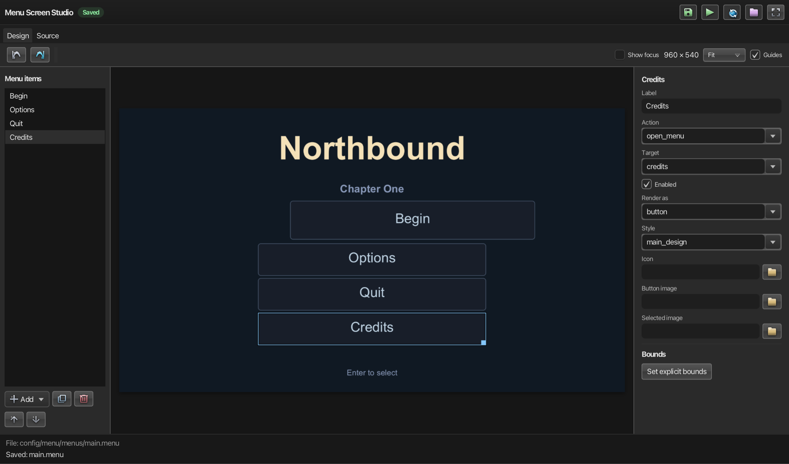
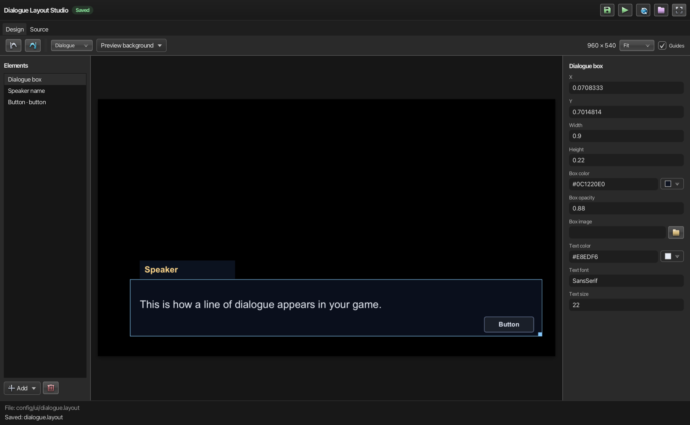

# Layout Authoring Tools

Open a menu or dialogue file from the **Layout Editors** sidebar or the project tree. Layout Studio opens in **Design**. The canvas uses JVN's JavaFX game renderer and reads the project's viewport size, theme, images, fonts, and linked layout and style. **Fit** scales the view to the space on screen. **100%** shows the canvas at its authored size. Turn off **Guides** to see a clean frame.

## Build a menu

1. Open **Layout Editors** and choose **New Menu**. Give the screen an ID, such as `credits`.
2. Click an empty part of the canvas to edit the screen title, subtitle, footer, background, layout, or default style.
3. Use **Add** to insert a button, heading, text block, or note. Select it on the canvas or from **Menu items**. Edit the label and style in the inspector.
4. For a button that opens another screen, choose `open_menu` and pick the target screen ID. Use `back` for a return button. For a custom action, type its existing action key.
5. Drag an item to position it. Drag the lower-right handle to resize it. Arrow keys nudge the selected item one game pixel. Hold Shift for ten pixels. **Reset to layout** clears the item's local position overrides so it follows the shared layout again.
6. Use the outline controls to duplicate, reorder, or remove items. To use this screen at startup, set it as the default in the menu registry.

Reordering changes the order used by the runtime for keyboard navigation and automatic placement. Explicitly positioned items keep their positions. Enable **Show focus** to inspect the selected style on supported screens.

## Shared menu layouts and styles

Open a menu `.layout` or `.style` file from the sidebar. The preview selector lists the menus that use it. An unassigned file uses a sample menu. Changes to a shared file affect its users when saved.

- **Layout** exposes the title and footer positions, list width, start position, spacing, text alignment, and visible row count. Drag the title, footer, or automatic rows when the active presentation exposes them.
- **Style** exposes the background, text colors, fonts, and button images. Use the color picker for a visual change or enter an exact hex value. An item's style or image override takes precedence over shared values.

## Dialogue

Open `config/ui/dialogue.layout` to position the dialogue box, speaker name, and textbox buttons. Switch the preview to **Choices** to move the sample choice stack or change the row size and gap. **Add → Dialogue button** creates a button you can position relative to the viewport or textbox. Use **Narration**, **NVL**, or **Bubble** to work on the other dialogue presentations. The preview uses a sample scene and a centered speaker anchor for bubbles. Use **Preview background** to check contrast against a project image. Play the actual project to verify script-specific dialogue, characters, backgrounds, and accessibility settings.

## Source, diagnostics, and testing

**Design** and **Source** share one working document and undo history. A complete drag is one undo step. Edits keep unrelated properties and comments in place. **Source** has syntax highlighting, line diagnostics, templates, a key reference, and asset import tools. The sidebar checks screen targets, registry membership, and cross-file references.

- **Ctrl/Cmd+S** saves the current file. **Reload** rereads the saved copy after confirmation if there are unsaved changes.
- **Ctrl/Cmd+Enter** saves and runs the project. Use it to exercise actions and input, script-driven UI, saved-game data, animation, and other runtime state.
- When you return to a Design window, Layout Studio picks up unsaved menu, layout, and style edits from other Studio windows in the same project.

## Related documentation

- [Layout DSL cookbook](../reference/layout-dsl-cookbook.md)
- [Validation and diagnostics](validation-diagnostics.md)
- [Dialogue layout](../components/dialogue-layout.md)
- [Menu layouts](../structure/menu-layouts.md)
- [Menu actions](../structure/menu-actions.md)
