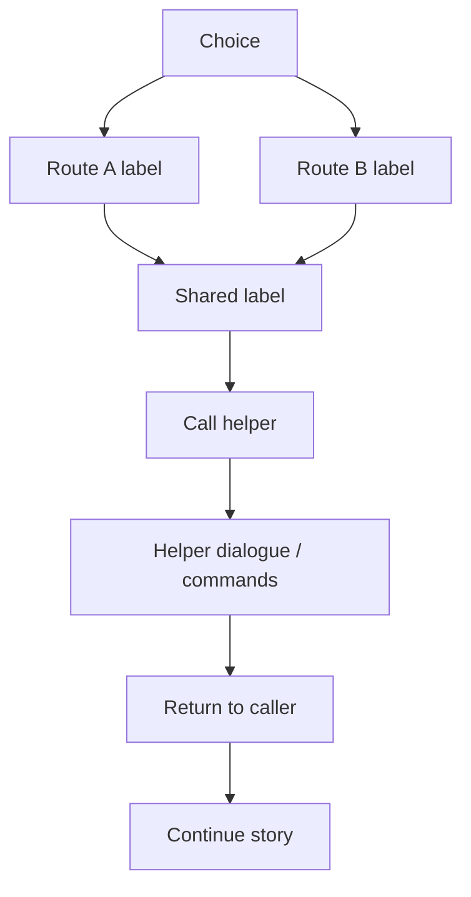

# VNS Subroutines & Flow Control



> [!NOTE]
> Use a jump when the current path is finished. Use a subroutine when you must return to the instruction after the call. Cross-file story routes also need a valid script or story-map target.

Complete reference for labels, jumps, subroutine calls, script switching, and structural flow patterns in VNS.

---

## Labels

Labels are named positions in a script that serve as jump targets.

### Syntax

```text
@label <name>
```

Legacy form (still accepted):

```text
label <name>
```

### Naming Rules

Label names must match: `^[A-Za-z_][A-Za-z0-9_.:-]*$`

- Must start with a letter or underscore
- Can contain letters, digits, dots, underscores, colons, and hyphens
- No spaces allowed
- Duplicate labels in the same script (including includes) are parse errors

### Examples

```vns
@label start
@label chapter1_intro
@label route_a.ending
@label hub:return_point
@label _internal_helper
```

---

## Jumps

### Unconditional Jump

```vns
[jump <label>]
```

Immediately transfers execution to the target label. The current position is **not** saved.

```vns
@label start
narrator: Choose your path.
> Go left -> left_path
> Go right -> right_path

@label left_path
narrator: You went left.
[jump merged]

@label right_path
narrator: You went right.
[jump merged]

@label merged
narrator: The paths converge.
```

### Conditional Jump

```vns
[if <condition> goto <label>]
```

Jumps only if the condition is true:

```vns
[if score >= 100 goto perfect]
[if score >= 50 goto good]
[jump bad]

@label perfect
narrator: Perfect score!
[end]

@label good
narrator: Well done!
[end]

@label bad
narrator: Try again.
[end]
```

---

## Conditional Blocks

Full if/elif/else/endif blocks for inline conditional content:

```vns
[if has_sword && sword_level >= 3]
  narrator: Your legendary blade shines.
[elif has_sword]
  narrator: Your sword is ready.
[else]
  narrator: You're unarmed.
[endif]
```

Blocks can be nested:

```vns
[if chapter >= 2]
  [if trust >= 5]
    narrator: Your ally stands beside you.
  [else]
    narrator: Your ally keeps their distance.
  [endif]
[else]
  narrator: You journey alone.
[endif]
```

Internally, the parser lowers blocks into synthetic labels and jumps, keeping the runtime execution model linear.

---

## Script End

```vns
[end]
```

Terminates the scenario. The runtime returns to the menu or exits depending on context.

---

## Subroutine Calls

### `[gosub <label>]`

Pushes the current position onto the call stack, then jumps to the target label. Use `[return]` at the end of the subroutine to pop back to the line after `[gosub]`.

```vns
@label start
narrator: Before the cutscene.
[gosub shared_cutscene]
narrator: After the cutscene — we're back.
[end]

@label shared_cutscene
narrator: This is a reusable subroutine.
narrator: It can be called from multiple places.
[return]
```

### `[return]`

Returns from a subroutine call by popping the return address from the call stack. Must be paired with a prior `[gosub]`.

```vns
[return]
```

If `[return]` is reached without a matching `[gosub]`, behavior is undefined (the call stack is empty).

### Subroutine patterns

**Reusable flashback:**

```vns
@label chapter1
narrator: Something triggered a memory.
[gosub flashback_01]
narrator: The memory fades.
[jump chapter1_continue]

@label chapter3
narrator: The same memory returns, stronger this time.
[gosub flashback_01]
narrator: Now you understand its meaning.
[jump chapter3_continue]

@label flashback_01
[transition FADE 800 old_room]
narrator: Years ago, in this very room...
[transition FADE 800]
[return]
```

**Note:** `[gosub]` is the subroutine call command. `[call <provider> <payload>]` is the general interop command (for JES, Java, timelines, etc.) — they are different commands despite both containing "call" in concept.

---

## Cross-Script Navigation

### `[goto <labelOrArc:label>]`

Jumps to a label, optionally loading a different script arc first.

```vns
# Jump within same script
[goto chapter2_start]

# Jump to a label in another script (arc:label syntax)
[goto Chapter2:beginning]
[goto RouteA:start]
```

When using `Arc:label` form, runtime loads the target script via `VnScenarioLoader` and jumps to that label.

### `[load <scriptOrId>]`

Loads and starts a different VNS script entirely.

```vns
[load scripts/story/chapter2.vns]
```

### `[mainmenu [script]]`

Returns to the main menu, optionally setting the default script.

```vns
[mainmenu]
[mainmenu scripts/story/prologue.vns]
```

---

## Menu Navigation

```vns
[menu settings]    # open settings menu
[menu save]        # open save menu
[menu load]        # open load menu
[menu main]        # return to main menu
[settings]         # shorthand for settings menu
```

---

## Flow Patterns

### Pattern: Linear Chapter Flow

```vns
@scenario chapter1
@label start
narrator: Chapter 1 begins.
# ... story content ...
@label end
[goto Chapter2:start]
```

### Pattern: Hub with Return

```vns
@label hub
narrator: You're in the village.
> Visit shop -> shop
> Visit tavern -> tavern
> Leave -> depart

@label shop
narrator: The shopkeeper waves.
[jump hub]

@label tavern
narrator: The tavern is lively.
[jump hub]

@label depart
narrator: You leave the village.
[end]
```

### Pattern: State Machine

```vns
@var phase = 1

@label game_loop
[if phase == 1 goto phase_explore]
[if phase == 2 goto phase_battle]
[if phase == 3 goto phase_resolve]
[jump game_over]

@label phase_explore
narrator: Exploration phase.
[set phase 2]
[jump game_loop]

@label phase_battle
narrator: Battle phase.
[set phase 3]
[jump game_loop]

@label phase_resolve
narrator: Resolution phase.
[jump game_over]

@label game_over
narrator: Game complete.
[end]
```

### Pattern: Retry Loop

```vns
@var attempts = 0

@label challenge
[inc attempts]
narrator: Attempt ${attempts}. Choose wisely.

> Open the red chest -> red
> Open the blue chest -> blue

@label red
narrator: It was a trap!
[if attempts >= 3 goto give_hint]
[jump challenge]

@label give_hint
narrator: (Hint: try the blue one.)
[jump challenge]

@label blue
narrator: You found the treasure!
narrator: It took you ${attempts} attempt(s).
[end]
```

### Pattern: Day/Night Cycle

```vns
@var day = 1

@label morning
[set time "morning"]
[bg town_morning]
narrator: Day ${day} — Morning.
# ... events ...
[jump afternoon]

@label afternoon
[set time "afternoon"]
[bg town_afternoon]
narrator: Day ${day} — Afternoon.
# ... events ...
[jump evening]

@label evening
[set time "evening"]
[bg town_evening]
narrator: Day ${day} — Evening.
# ... events ...
[inc day]
[if day > 7 goto finale]
[jump morning]

@label finale
narrator: The final day has come.
[end]
```

---

## Related Docs

- [VNS Overview](../overview/vns-scripting.md)
- [Variables & Conditions](../language/vns-variables.md) — condition expressions
- [Choices & Branching](../language/vns-choices.md) — choice-driven flow
- [Commands Reference](../language/vns-commands.md) — full command list
- [Interop & Integration](../integration/vns-interop.md) — JES/Java integration
